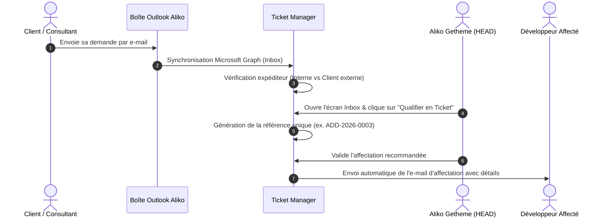

# 📋 CAHIER DES CHARGES — TICKET MANAGER
## Plateforme Intelligente de Gestion des Tickets, des Addons SAP et de la Capacité de Développement

---

| **Document** | **Cahier des Charges Fonctionnel & Technique** |
|---|---|
| **Projet** | **Ticket Manager** (Plateforme de pilotage BU SME) |
| **Entreprise** | **Safir Consulting** |
| **Destinataire / Validateur** | **Aliko Getheme** — *Head of SME Business Unit & Development Team* |
| **Version** | **1.0 (Référence de Présentation Direction)** |
| **Statut** | **Validé & Prêt pour Exploitation** |
| **Dépôt Source** | [https://github.com/MohaDicko/gestion_ticketSAFIR](https://github.com/MohaDicko/gestion_ticketSAFIR) |

---

## 📑 SOMMAIRE EXÉCUTIF

- [1. Contexte Métier & Rôle Central du Responsable](#1-contexte-métier--rôle-central-du-responsable)
- [2. Problématique & Objectifs Stratégiques](#2-problématique--objectifs-stratégiques)
- [3. Typologie des Demandes & Spécificités SAP](#3-typologie-des-demandes--spécificités-sap)
- [4. Module Messagerie & Flux E-mail Outlook Microsoft 365](#4-module-messagerie--flux-e-mail-outlook-microsoft-365)
- [5. Référentiel Équipe des 7 Développeurs & Compétences](#5-référentiel-équipe-des-7-développeurs--compétences)
- [6. Moteur de Calcul de Capacité Nette (Sans Double Décompte)](#6-moteur-de-calcul-de-capacité-nette-sans-double-décompte)
- [7. Moteur d'Aide à l'Affectation (Algorithme Décisionnel sur 100 Points)](#7-moteur-daide-à-laffectation-algorithme-décisionnel-sur-100-points)
- [8. Cycle de Vie des Demandes & Machine à États Finis](#8-cycle-de-vie-des-demandes--machine-à-états-finis)
- [9. Architecture Technique & Hébergement sur Serveur SAP](#9-architecture-technique--hébergement-sur-serveur-sap)
- [10. Sécurité, Traçabilité & Confidentialité (RBAC)](#10-sécurité-traçabilité--confidentialité-rbac)
- [11. Plan de Déploiement & Livrables](#11-plan-de-déploiement--livrables)

---

## 1. CONTEXTE MÉTIER & RÔLE CENTRAL DU RESPONSABLE

Au sein de **Safir Consulting**, la **SME Business Unit** assure la conception, le développement, l'intégration et la maintenance de solutions de gestion d'entreprise, principalement centrées sur les écosystèmes **SAP Business One (SAP B1)** et **SAP S/4HANA**.

### 1.1. L'Organisation Actuelle
- **Aliko Getheme** (Head of SME Business Unit) assure le rôle de **point focal stratégique et opérationnel** :
  - Il reçoit les demandes des **consultants fonctionnels** et des **clients finaux**.
  - Il évalue la criticité, estime l'effort et décide de l'attribution de chaque demande.
  - Il garantit le respect des engagements de livraison contractuels auprès des clients.
- **L'équipe de réalisation** est composée d'un effectif de **7 développeurs réels** (+ Direction et Consulting Fonctionnel, soit 9 collaborateurs au total), ayant chacun des niveaux d'expertise distincts (SDK SAP, Service Layer, ABAP, Fiori, interfaces Web, bases de données HANA/SQL).

```
   [Clients Externes & Consultants Safir]
                     │
                     ▼ (Demandes entrantes par E-mail)
         ┌─────────────────────────┐
         │      Aliko Getheme      │ ◄── Point Central de Qualification
         │ (Head of SME Bus. Unit) │     et d'Arbitrage des Priorités
         └───────────┬─────────────┘
                     │ (Affectation optimisée & traçable)
                     ▼
       [ Équipe des 7 Développeurs ]
  (SAP B1 · S/4HANA · API · Full-Stack)
```

---

## 2. PROBLÉMATIQUE & OBJECTIFS STRATÉGIQUES

### 2.1. Les Défis Constatés
1. **Dispersion des demandes** : Flux asynchrones d'e-mails dans la boîte personnelle d'Aliko sans visibilité partagée sur l'état d'avancement.
2. **Risque de saturation des développeurs clés** : Tendance naturelle à sur-solliciter les profils seniors (Anoop, Hassane) au détriment du reste de l'équipe.
3. **Calcul de capacité approximatif** : Risque de double décompte entre congés, jours fériés et heures déjà réservées sur d'autres projets.
4. **Perte de traçabilité des arbitrages** : Manque d'historique lorsqu'une demande urgente bouscule le planning prévu.

### 2.2. Objectifs Attendus de la Plateforme
- **Visibilité en temps réel à 100%** sur la charge réelle et la capacité nette des 7 développeurs.
- **Zéro ressaisie** : Transformation directe d'un e-mail client en ticket d'intervention structuré.
- **Aide à la décision objective** : Recommandation algorithmique du meilleur développeur disponible pour chaque demande, basée sur les compétences exigées et l'échéance.
- **Garantie d'absence de conflit SAP** : Déploiement étanche pouvant cohabiter sans risque sur les serveurs d'infrastructure SAP de l'entreprise.

---

## 3. TYPOLOGIE DES DEMANDES & SPÉCIFICITÉS SAP

Les demandes traitées par la SME Business Unit sont catégorisées avec une numérotation annuelle automatique normalisée :

| Préfixe | Catégorie | Description & Exemples SAP | Validation Critères |
|:---:|---|---|:---:|
| **`ADD-`** | **Addon SAP Spécifique** | Nouveau module greffé sur SAP B1 (SDK, Service Layer) ou S/4HANA (RAP/CAP) | **Obligatoire** |
| **`BUG-`** | **Correction d'Anomalie** | Dysfonctionnement bloquant ou non (ex: écart d'écriture CDS Views, crash Service Layer) | Optionnel |
| **`EVO-`** | **Évolution Fonctionnelle** | Modification d'un flux existant, ajout de colonnes ou d'écrans dans SAP Fiori | **Obligatoire** |
| **`DEV-`** | **Développement Sur-Mesure** | Programme spécifique client indépendant (traitement par lot, passerelle) | **Obligatoire** |
| **`INT-`** | **Intégration & API** | Connecteur e-commerce, WMS, CRM vers SAP Business One | **Obligatoire** |
| **`MNT-`** | **Maintenance Technique** | Migration de version, mise à niveau de patch SAP B1, optimisation SQL | Optionnel |
| **`SUP-`** | **Assistance & Support** | Accompagnement technique utilisateur, diagnostic d'incident | Optionnel |
| **`ANA-`** | **Analyse & Étude** | Cadrage technique, faisabilité d'un addon ou audit d'architecture | Optionnel |

---

## 4. MODULE MESSAGERIE & FLUX E-MAIL OUTLOOK MICROSOFT 365

L'intégration e-mail est conçue pour respecter les habitudes de travail d'Aliko sans le contraindre à des tâches manuelles de copier-coller :



### 4.1. Règles de Rapprochement et Typologie des Expéditeurs

La boîte de réception d'Aliko centralise des demandes issues d'acteurs aux statuts variés. Le système applique un aiguillage strict selon 4 catégories d'expéditeurs :

1. **Consultants & Collaborateurs Internes Safir** (`SenderKind.CONSULTANT` / `INTERNAL_TEAM`) :
   - Reconnaissance automatique via le nom de domaine de messagerie d'entreprise `@safirconsulting.net`.
   - Tout consultant interne (comme **Mélissa Diakité** ou d'autres consultants Safir) peut adresser des besoins, spécifications ou cahiers des charges directement à Aliko sans risque de blocage.
   - L'e-mail est instantanément qualifié avec un niveau de confiance maximal (**Badge « 🏢 Consultante / Équipe Safir »**).

2. **Contacts Clients Officiels Référencés** (`SenderKind.CLIENT_CONTACT`) :
   - Rapprochement immédiat avec la fiche du compte client grâce au domaine d'entreprise enregistré (ex: `@client-omega.com` pour Omega Logistics).
   - Le message est directement lié au compte client et à ses projets actifs (**Badge « 🤝 Contact Client Officiel »**).

3. **Personnes Extérieures à l'Entreprise / Nouveaux Contacts** (`SenderKind.UNKNOWN`) :
   - Tout tiers externe à Safir Consulting n'appartenant pas à un domaine client connu (ex: nouveaux prospects, partenaires, sous-traitants, autres sociétés).
   - L'e-mail est accueilli dans l'Inbox avec le statut d'attente (**Badge « 🌐 Personne Extérieure »**).
   - Aliko dispose d'actions guidées en un clic :
     - *Créer un nouveau compte Client & Contact* et qualifier le ticket.
     - *Rattacher l'expéditeur à un Client existant* (nouveau collaborateur chez le client).
     - *Classer sans suite / Archiver / Rejeter* (prospection commerciale non sollicitée ou SPAM).

4. **Adresses Personnelles (Gmail, Yahoo, Hotmail, etc.) & Bouclier Anti-usurpation** :
   - Couramment utilisées par certains consultants externes indépendants ou dirigeants de PME.
   - **Contrôle de sécurité strict** : Si l'adresse personnelle a déjà été explicitement validée par Aliko dans la fiche du client, elle est acceptée en toute confiance. À défaut, le système affiche un **Badge d'alerte rouge « ⚠️ Vigilance : Domaine personnel non validé »** afin d'empêcher toute modification non autorisée ou ingénierie sociale.

---

## 5. RÉFÉRENTIEL ÉQUIPE DES 7 DÉVELOPPEURS & COMPÉTENCES

L'effectif de l'équipe de développement Safir Consulting est formalisé avec des fiches individuelles évaluées de **1 (Notions)** à **5 (Expert Référent)** :

| # | Développeur | E-mail | Rôle Principal | Compétences Clés & Niveaux | Capacité Hebdo |
|:---:|---|---|---|---|:---:|
| 1 | **Anoop Pandimukkula** | `anoop.pandimukkula@safirconsulting.net` | Senior Développeur SAP B1 & Addons | Service Layer (5), UI/DI API (5), HANA SQL (4) | 40 h / sem |
| 2 | **Hassane Bocoum** | `hassane.bocoum@safirconsulting.net` | Lead Développeur SAP S/4HANA & ABAP | S/4HANA ABAP & CDS (5), Fiori/UI5 (4), HANA SQL (4) | 40 h / sem |
| 3 | **Nevrit Ahua** | `nevrit.ahua@safirconsulting.net` | Ingénieur Intégration Systèmes & API | Architecture API (5), Service Layer (4), NestJS (4) | 40 h / sem |
| 4 | **Fatoumata Traore** | `fatoumata.traore@safirconsulting.net` | Développeuse Full-Stack & Fiori UX | Next.js/React (5), Fiori/UI5 (4), NestJS (4) | 40 h / sem |
| 5 | **Korotoumou Thiam** | `korotoumou.thiam@safirconsulting.net` | Développeuse Backend & Bases de données | PostgreSQL/Prisma (5), NestJS (4), HANA SQL (4), Docker (4) | 40 h / sem |
| 6 | **Moha Dicko** | `mohadicko95@gmail.com` | Lead Full-Stack & Architecte Solution | React/Next.js (5), NestJS (5), PostgreSQL (5), Architecture API (5) | 40 h / sem |
| 7 | **Jean-Philippe Ebrottié** | `jeanphilippe.ebrottie@safirconsulting.net` | Développeur Solutions SAP B1 & Intégration | UI/DI API (4), Service Layer (4), HANA SQL (3) | 40 h / sem |

### 5.1. Consultants Fonctionnels Référents
- **Mélissa Diakité** (`melissa.diakite@safirconsulting.net`) : Consultante Fonctionnelle SAP (Safir Consulting) — interlocutrice métier émettrice des besoins, interlocutrice pour les spécifications fonctionnelles et la recette applicative.

### 5.2. Évolutivité de l'Équipe & Onboarding Dynamique par Aliko
Pour accompagner l'agrandissement futur de la SME Business Unit, la plateforme permet à **Aliko Getheme (HEAD)** d'intégrer en temps réel de nouveaux développeurs dans son équipe :
- Renseignement de l'identité (prénom, nom, e-mail d'entreprise).
- Spécialité technique SAP (SAP B1 SDK, S/4HANA ABAP & CDS, Service Layer, Full-Stack Fiori).
- Paramétrage de la capacité hebdomadaire contractuelle (ex: 40h/semaine).
- Évaluation de la compétence clé d'entrée (Niveaux 1 à 5).
Le profil est instantanément injecté dans le référentiel d'équipe, mis à jour dans le tableau de bord de capacité et éligible au moteur de scoring d'affectation.

### 5.3. Création & Provisioning des Profils Consultants Fonctionnels
Aliko Getheme dispose également de l'habilitation exclusive pour intégrer de nouveaux **Consultants Fonctionnels** dans l'application :
- **Attribution des identifiants (Login)** : L'adresse e-mail professionnelle déclarée (ex: `@safirconsulting.net`) constitue le login unique de connexion par défaut.
- **Mot de passe initial sécurisé** : Saisie d'un mot de passe initial de connexion (chiffré via l'algorithme robuste **Argon2id**).
- **Rattachement organisationnel & Spécialité** : Précision de l'organisation (*Safir Consulting* ou cabinet partenaire) et de sa spécialité SAP (ex: *FI/CO, Supply Chain, WMS, Achats*).
Dès sa création, le consultant peut se connecter immédiatement à son espace dédié pour émettre de nouveaux besoins SAP, transmettre des spécifications fonctionnelles et suivre en temps réel la réalisation technique par l'équipe de développement.

---

## 6. MOTEUR DE CALCUL DE CAPACITÉ NETTE (SANS DOUBLE DÉCOMPTE)

Le calcul de disponibilité repose sur une formule mathématique rigoureuse empêchant toute surréservation invisible :

$$\mathbf{Capacité\_Nette}(d, t) = \mathbf{Contractuelle}(d, t) - \mathbf{Absences\_Validées}(d, t) - \mathbf{Jours\_Fériés}(t)$$

$$\mathbf{Charge\_Restante}(d, t) = \sum_{a \in \text{Affectations}} \mathbf{Reste\_À\_Faire}(a, t)$$

$$\mathbf{Capacité\_Disponible}(d, t) = \max\Big(0,\; \mathbf{Capacité\_Nette}(d, t) - \mathbf{Charge\_Restante}(d, t)\Big)$$

### Principes Directeurs
- **Pas de double décompte** : Un congé posé sur un jour férié n'est déduit qu'une seule fois.
- **Temps réel** : Dès qu'un développeur saisit ses heures ou met à jour son reste à faire, la jauge de charge se rafraîchit immédiatement pour Aliko.
- **Indicateur de fraîcheur** : Si un développeur n'a pas mis à jour son reste à faire depuis plus de 7 jours, une alerte signale une fiabilité amoindrie de la prévision.

---

## 7. MOTEUR D'AIDE À L'AFFECTATION (ALGORITHME DÉCISIONNEL SUR 100 POINTS)

Pour chaque ticket en statut `READY`, le moteur applique une évaluation en deux temps :

### Étape 1 : Le Filtrage Éliminatoire (Admissibilité)
Un développeur est **strictement éliminé** de la recommandation si :
- Son profil est inactif ou en congé total sur la période d'exécution.
- Il possède un niveau inférieur au niveau minimal requis sur **une seule compétence obligatoire** (ex: si un addon requiert *Service Layer Niveau 4*, un développeur de Niveau 3 est éliminé).
- Une exclusion client explicite a été paramétrée.

### Étape 2 : Le Calcul du Score Déterministe sur 100 Points

| Critère | Poids | Règle de Calcul |
|---|:---:|---|
| **Compétences Techniques** | **45 pts** | Évalue l'adéquation entre le niveau du développeur et l'exigence du ticket. Prime accordée à l'expertise supérieure. |
| **Capacité & Disponibilité** | **30 pts** | 30 pts si charge $\le 50\%$, 22 pts si charge $\le 75\%$, 14 pts si charge $\le 90\%$, 0 pt en cas de surcharge. |
| **Respect de l'Échéance** | **15 pts** | Capacité à finaliser l'effort estimé avant la date limite demandée par le client. |
| **Continuité Client / Projet** | **10 pts** | +10 pts si le développeur a déjà livré avec succès sur ce même client ou projet (connaissance du code existant). |

> **Liberté du Responsable (Override)** : Aliko conserve en permanence le pouvoir d'affecter un développeur différent du premier classé. Dans ce cas, la plateforme lui demande simplement un motif de dérogation (ex: *« Volonté de montée en compétences d'un profil sur ce flux »*), consigné dans le journal d'audit.

---

## 8. CYCLE DE VIE DES DEMANDES & MACHINE À ÉTATS FINIS

Le ticket suit un cheminement maîtrisé garantissant la conformité contractuelle avant livraison :

```
[ RECEIVED ] ──► [ TO_QUALIFY ] ──► [ READY ] ──► [ ASSIGNED ] ──► [ IN_PROGRESS ]
      │                │                                                   │
      ▼                ▼                                                   ├──► [ BLOCKED ] (Motif obligatoire)
 [ REJECTED ]    [ REJECTED ]                                              │          │
                                                                           │          ▼ (Reprise statut antérieur)
                                                                           │    [ IN_PROGRESS ]
                                                                           │
                                                                           ▼
                                                                   [ IN_TESTING / REVIEW ]
                                                                           │
                                                                           ▼
                                                                     [ DELIVERED ]
                                                                           │
                                                                           ▼ (Validation Aliko)
                                                                      [ CLOSED ]
```

### Règles de Transition Majeures
1. **Passage à `READY`** : Doit obligatoirement avoir un client identifié, une estimation d'effort en heures, et des critères d'acceptation définis pour les Addons (`ADD-`).
2. **Passage à `ASSIGNED`** : Déclenché automatiquement lors de la validation de l'affectation par Aliko.
3. **Statut `BLOCKED`** : Tout développeur peut signaler un blocage (ex: *« Attente accès VPN client »* ou *« Licence SAP B1 expirée »*). Le compteur de durée de blocage s'active.
4. **Validation de Clôture (`DELIVERED` ➔ `CLOSED`)** : Réservée exclusivement à Aliko après confirmation de la recette client.

---

## 9. ARCHITECTURE TECHNIQUE & HÉBERGEMENT SUR SERVEUR SAP

Pour répondre aux contraintes d'infrastructure de Safir Consulting, le système est conçu pour être hébergé sur les serveurs d'infrastructure **SAP Business One** ou **SAP S/4HANA** de l'entreprise :

```
   ┌─────────────────────────────────────────────────────────────┐
   │        SERVEUR D'INFRASTRUCTURE SAP (Hôte Physique / VM)    │
   │  (Windows Server / SUSE Linux Enterprise / Red Hat Linux)   │
   │                                                             │
   │  [ Services SAP Natifs ]                                    │
   │  - Instance SAP HANA (Ports 3xx15)                          │
   │  - Service Layer SAP B1 (Port 50000 / 50001)                │
   │  - Services SLD, License Server, SAProuter                  │
   │                                                             │
   │  ┌───────────────────────────────────────────────────────┐  │
   │  │   ISOLATION TOTALE PAR CONTENEURISATION (Docker)       │  │
   │  │                                                       │  │
   │  │  [ Conteneur Frontend ]     Next.js 15 (Port 3000)    │  │
   │  │  [ Conteneur Backend API ]  NestJS (Port 4000)        │  │
   │  │  [ Conteneur Base Dédiée ]  PostgreSQL 16 (Port 5432) │  │
   │  │                                                       │  │
   │  │  -> Zéro modification des bibliothèques système hôte   │  │
   │  │  -> Zéro pollution des bases HANA / SQL Server SAP    │  │
   │  │  -> Zéro impact sur les licences SAP de l'entreprise  │  │
   │  └───────────────────────────────────────────────────────┘  │
   └─────────────────────────────────────────────────────────────┘
```

### Les 4 Garanties d'Étage Technique :
1. **Étanchéité Logicielle** : Fonctionnement sous conteneurs légers Docker / Podman.
2. **Indépendance des Données** : Base de données **PostgreSQL 16** dédiée (actuellement connectée sur Supabase en cloud, déployable localement sur le serveur SAP via `docker-compose.yml`).
3. **Aucun Conflit de Ports** : Les ports de Ticket Manager (`3000` et `4000`) sont totalement disjoints des ports réservés SAP.
4. **Fiabilité des Notifications (Outbox Pattern)** : Tout envoi d'e-mail est consigné en base avant expédition. En cas d'indisponibilité momentanée du réseau, le message n'est jamais perdu et part dès le rétablissement.

---

## 10. SÉCURITÉ, GOUVERNANCE & CLOISONNEMENT DES RÔLES (RBAC)

L'application intègre un contrôle d'accès fondé sur les rôles (RBAC) garantissant l'étanchéité des données et une expérience sur-mesure pour chaque collaborateur de Safir Consulting :

### 10.1. Matrice des Droits et Grants

| Fonctionnalité / Périmètre | `HEAD` (Aliko) | `DEVELOPER` (Équipe) | `CONSULTANT` (Mélissa) | `ADMIN` (IT) |
|---|:---:|:---:|:---:|:---:|
| **Boîte de Réception Outlook M365 & Scoring d'Urgence** | ✅ | ❌ | ❌ | ✅ |
| **Gouvernance Globale, Suivi Capacité & Alertes Surcharge** | ✅ | ❌ | ❌ | ✅ |
| **Attribution des Tickets & Dérogations de Charge** | ✅ | ❌ | ❌ | ❌ |
| **Espace Développeur Personnalisé (Mes Tickets Dédiés)** | ✅ (Vue globale) | ✅ (Strictement les siens) | ❌ | ✅ |
| **Saisie Reste à Faire (RAF en heures)** | ✅ | ✅ | ❌ | ❌ |
| **Déclaration de Blocage d'Urgence (« Stop-the-line »)** | ✅ | ✅ | ❌ | ❌ |
| **Livraison de Ticket pour Recette** | ✅ | ✅ | ❌ | ❌ |
| **Suivi Transparent de ses Demandes Émises** | ✅ | ❌ | ✅ | ✅ |
| **Formulaire de Soumission Directe de Nouveau Besoin** | ✅ | ❌ | ✅ | ✅ |
| **Intégration d'un Nouveau Développeur (Onboarding Équipe)** | ✅ | ❌ | ❌ | ✅ |
| **Création de Profils Consultants & Attribution des Logins** | ✅ | ❌ | ❌ | ✅ |
| **Validation Clôture Définitive (`CLOSED`)** | ✅ | ❌ | ❌ | ❌ |
| **Pondération des Critères de Scoring & Règle Métier** | ✅ | ❌ | ❌ | ✅ |
| **Journal d'Audit Immuable & Traçabilité** | ✅ | ❌ | ❌ | ✅ |

### 10.2. Expérience et Cloisonnement par Profil

0. **Portail d'Authentification Sécurisé par Défaut (`/`)** :
   - **Arrivée par défaut** : Tout utilisateur non connecté arrive impérativement sur la page d'authentification d'entreprise corporate Safir Consulting.
   - **Identifiants & Sécurité** : Saisie du login (adresse e-mail professionnelle) et du mot de passe initial chiffré via Argon2id, ou sélection rapide 1-clic pour les scénarios de démonstration.
   - **Routage Automatique vers le Portail Dédié** : Dès validation, l'utilisateur est immédiatement orienté vers **son propre portail de travail** selon son profil RBAC (`HEAD` vers le Tableau de Bord Direction, `DEVELOPER` vers son Espace Développeur personnel, `CONSULTANT` vers son Espace Demandes Métier).
   - **Déconnexion Directe** : Bouton de déconnexion explicite (`LogOut`) accessible en permanence dans l'en-tête pour clôturer la session et retourner à l'écran de connexion.

1. **Espace Direction (`HEAD` — Aliko Getheme)** :
   - Vision consolidée à 360° : boîte de réception Outlook M365 (e-mails entrants, analyse anti-spoofing, scoring d'urgence).
   - Suivi en temps réel de la capacité de l'équipe (heures disponibles vs heures RAF réelles, taux de saturation).
   - Matrice Kanban et liste complète des tickets pour arbitrages d'affectation et validations.
   - **Supervision Continue & Œil Direction sur l'Avancement** : Contrôle visuel permanent de la progression de chaque ticket jusqu'à son règlement complet (`CLOSED`), avec barre d'avancement (%), suivi en temps réel du RAF saisi par les développeurs, modale de supervision 360° (`Eye`) avec stepper 6 étapes, levée de blocage et validation finale de clôture.

2. **Espace Développeur (`DEVELOPER` — Anoop, Moha, Hassane, etc.)** :
   - **Isolation stricte** : la boîte e-mail de la direction et les métriques globales d'équipe sont masquées.
   - Accès exclusif à la liste de ses **propres tickets assignés** classés par statut opérationnel.
   - **Saisie du RAF (Reste à Faire)** : mise à jour instantanée du temps restant nécessaire avec recalcul automatique de la charge de travail.
   - **Stop-the-line (Blocage)** : déclaration immédiate d'un point de blocage avec motif obligatoire pour remonter l'alerte à la direction sans délai.
   - **Livraison** : passage du ticket en statut *Livré* dès achèvement des travaux.

3. **Espace Métier / Consultante (`CONSULTANT` — Mélissa Diakité)** :
   - **Visibilité totale sur le Développeur Dédié** : nom, avatar, e-mail professionnel et statut du développeur assigné à chacun de ses tickets.
   - **Jauge de progression en temps réel** : pourcentage d'avancement dynamique (`getTicketProgress`), barre visuelle animée et décompte Charge estimée vs Reste à Faire (RAF).
   - **Bannière d'alerte pour précision requise** : détection immédiate des tickets en pause nécessitant des éléments métier ou un jeu d'écritures.
   - **Dialogue direct Développeur ↔ Consultante** : fil de discussion contextuel horodaté permettant de répondre aux questions du développeur et de débloquer le ticket en un clic sans goulot d'étranglement.
   - **Soumission directe** : formulaire dédié pour soumettre directement un nouveau ticket dans le système sans transiter par une chaîne de mails informelle.

4. **Fil de Discussion Tracé & Collaboration Sans Goulot d'Étranglement** :
   - Le développeur peut poser une question au consultant et signaler le besoin comme bloquant (`status: BLOCKED`).
   - Le consultant est alerté sur son espace, apporte sa réponse et peut lever automatiquement le blocage (`status: IN_PROGRESS`).
   - Aliko (Direction BU SME) supervise l'intégralité du dialogue dans sa modale de supervision pour arbitrer si nécessaire tout en conservant l'historique complet.

5. **Affectation Multi-Développeurs par Brique Technique SAP (Lots Spécialisés)** :
   - **Répartition multi-niveaux par Aliko** : Capacité d'affecter plusieurs développeurs sur un même ticket complexe avec répartition par spécialité technique SAP :
     - *Addon SAP B1 (UI / DI API / C# .NET)*
     - *Intégration HANA & Vues SQLScript*
     - *API & Service Layer (Node.js / OData / REST)*
     - *ABAP Core & Extensions Cloud*
     - *Architecture Fullstack & Intégration Système*
     - *Recette Technique & Assurance Qualité (QA)*
   - **Pilotage Individualisé du Reste à Faire (RAF)** : Chaque développeur affecté à son lot visualise sa brique dédiée sur son espace, déclare son RAF spécifique, qui met à jour instantanément la charge consolidée du projet.
   - **Supervision 360° par Aliko** : Affichage d'un tableau synthétique de l'équipe mobilisée, des heures allouées et du pourcentage d'avancement par brique technique.
   - **Transparence Consultant** : La consultante (Mélissa) visualise l'ensemble des développeurs mobilisés et leurs domaines techniques respectifs.

6. **Sélecteur de Session Interactif (1-Clic)** :
   - Sélecteur de profil corporate intégré dans l'en-tête permettant de basculer instantanément entre Aliko, Anoop, Moha et Mélissa pour les besoins de validation, tests et démonstrations.

---

## 11. PLAN DE DÉPLOIEMENT & LIVRABLES

### 11.1. État Actuel du Projet (Prêt pour Démonstration & Exploitation)
- ✅ **Base de Données Supabase PostgreSQL 16** : 22 tables créées, schéma Prisma appliqué, relations et contraintes d'intégrité en place.
- ✅ **Jeu de Données Initial (Seed)** : 7 développeurs réels Safir Consulting (Moha Dicko, Anoop Pandimukkula, Hassane Bocoum, Nevrit Ahua, Fatoumata Traore, Korotoumou Thiam, Jean-Philippe Ebrottié), consultante Mélissa Diakité, compétences SAP et tickets enregistrés.
- ✅ **Backend API REST NestJS** : Opérationnel sur `http://localhost:4000/api/v1` avec contrôleurs de tickets, qualification d'expéditeurs (Consultant Safir, Contact Client, Externe, Alerte anti-usurpation Gmail) et moteur de scoring.
- ✅ **Frontend Next.js 15 App Router** : Opérationnel sur `http://localhost:3000` avec interface entreprise authentique, sobre et ergonomique (Page de login d'accueil par défaut, Tableau de bord de synthèse, Grand tableau des tickets SAP, Fiches de capacité de l'équipe, Boîte de réception Outlook M365 connectée).
- ✅ **Contrôle d'Accès & Espaces Multi-Utilisateurs (RBAC)** : Cloisonnement strict entre Direction (Aliko), Développeurs (Anoop, Moha, Hassane - saisie RAF, Stop-the-line, livraison) et Consultante (Mélissa - visibilité dev dédié, barre d'avancement, dialogue direct et soumission de besoins), avec sélecteur de session instantané et déconnexion.
- ✅ **Préparation Déploiement Vercel** : Configuration monorepo complète (`vercel.json`, script `vercel-build`, proxy dynamique d'API et documentation pas-à-pas des variables d'environnement).
- ✅ **Banc de Tests E2E Automatisé** : Script de qualification exécutable (`scratch/test_e2e_scenarios.ps1`) validé à 100% (9 PASS / 0 FAIL).
- ✅ **Banc de Tests Unitaires & Métier Vitest** : 36 tests automatisés validés à 100% (36 PASS / 0 FAIL) couvrant le scoring sur 100 points, le calcul de capacité nette, la classification e-mails, la machine à états finis, le provisioning de consultants (login = email pro, hachage Argon2id) et l'onboarding dynamique de développeurs.
- ✅ **Banc de Tests E2E Navigateur Playwright** : 12 scénarios complets sous Chromium (12 PASS / 0 FAIL) validant l'arrivée sur la page de login par défaut, l'accès au portail dédié, le cycle complet, le cloisonnement RBAC, les filtres, l'onboarding, la supervision continue d'Aliko, la visibilité du développeur dédié et de la progression par la consultante, le dialogue direct avec déblocage automatique, ainsi que l'affectation multi-développeurs par lot technique avec pilotage du reste à faire par brique.
- ✅ **Audit de Sécurité OWASP ZAP & Top 10** : 11 contrôles validés à 100% (étanchéité des grants RBAC pour la création de comptes, absence de fuite de hachage de mot de passe, protection anti-usurpation Gmail, requêtage paramétré Prisma contre les injections SQL, en-têtes défensifs, script `run_owasp_zap_scan.ps1` et profil `zap-baseline.conf`).
- ✅ **Dépôt Git & Versionnement** : Code source complet documenté et synchronisé sur [GitHub](https://github.com/MohaDicko/gestion_ticketSAFIR).

### 11.2. Feuille de Route pour Mise en Production
1. **Revue & Validation par Aliko** : Démonstration sur le poste de travail des flux d'affectation, de la vue développeur (RAF / Stop-the-line) et de la boîte de réception.
2. **Raccordement Office 365 Réel** : Renseignement des clés d'accès Azure Entra ID pour basculer du mode simulation vers la boîte de réception réelle.
3. **Déploiement sur l'Hôte SAP** : Lancement du `docker-compose.yml` sur le serveur cible de Safir Consulting.

---

> **Validation du Document**  
> **Pour Safir Consulting — SME Business Unit**  
> *Présenté par l'équipe projet à l'attention de M. Aliko Getheme.*  
> Date : *Octobre 2026*
