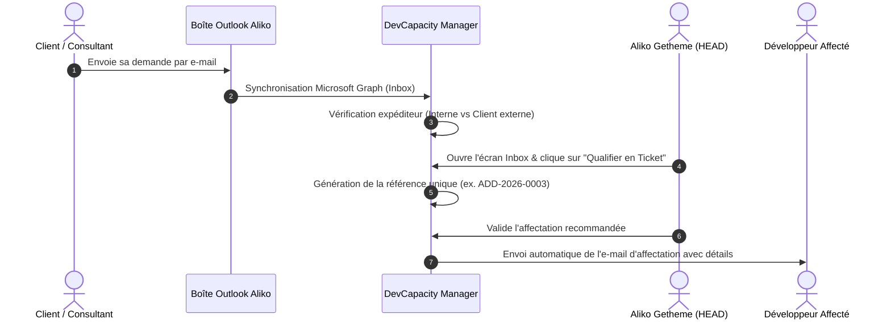

# 📋 CAHIER DES CHARGES — DEVCAPACITY MANAGER
## Plateforme Intelligente de Gestion des Tickets, des Addons SAP et de la Capacité de Développement

---

| **Document** | **Cahier des Charges Fonctionnel & Technique** |
|---|---|
| **Projet** | **DevCapacity Manager** (Plateforme de pilotage BU SME) |
| **Entreprise** | **Safir Consulting** |
| **Destinataire / Validateur** | **Aliko Getheme** — *Head of SME Business Unit & Development Team* |
| **Version** | **1.0 (Référence de Présentation Direction)** |
| **Statut** | **Validé & Prêt pour Exploitation** |
| **Dépôt Source** | [https://github.com/MohaDicko/gestion_ticketSAFIR](https://github.com/MohaDicko/gestion_ticketSAFIR) |

---

## 📑 SOMMAIRE EXÉCUTIF

- [1. Contexte Métier & Rôle Central du Responsable](#1-contexte-métier--rôle-central-du-responsable)
- [2. Problématique & Objectifs Stratégiques](#2-problématique--objectifs-stratégiques)
- [3. Typologie des Demandes & Spécificités SAP](#3-typologie-des-demandes--spécificités-sap)
- [4. Module Messagerie & Flux E-mail Outlook Microsoft 365](#4-module-messagerie--flux-e-mail-outlook-microsoft-365)
- [5. Référentiel Équipe des 8 Développeurs & Compétences](#5-référentiel-équipe-des-8-développeurs--compétences)
- [6. Moteur de Calcul de Capacité Nette (Sans Double Décompte)](#6-moteur-de-calcul-de-capacité-nette-sans-double-décompte)
- [7. Moteur d'Aide à l'Affectation (Algorithme Décisionnel sur 100 Points)](#7-moteur-daide-à-laffectation-algorithme-décisionnel-sur-100-points)
- [8. Cycle de Vie des Demandes & Machine à États Finis](#8-cycle-de-vie-des-demandes--machine-à-états-finis)
- [9. Architecture Technique & Hébergement sur Serveur SAP](#9-architecture-technique--hébergement-sur-serveur-sap)
- [10. Sécurité, Traçabilité & Confidentialité (RBAC)](#10-sécurité-traçabilité--confidentialité-rbac)
- [11. Plan de Déploiement & Livrables](#11-plan-de-déploiement--livrables)

---

## 1. CONTEXTE MÉTIER & RÔLE CENTRAL DU RESPONSABLE

Au sein de **Safir Consulting**, la **SME Business Unit** assure la conception, le développement, l'intégration et la maintenance de solutions de gestion d'entreprise, principalement centrées sur les écosystèmes **SAP Business One (SAP B1)** et **SAP S/4HANA**.

### 1.1. L'Organisation Actuelle
- **Aliko Getheme** (Head of SME Business Unit) assure le rôle de **point focal stratégique et opérationnel** :
  - Il reçoit les demandes des **consultants fonctionnels** et des **clients finaux**.
  - Il évalue la criticité, estime l'effort et décide de l'attribution de chaque demande.
  - Il garantit le respect des engagements de livraison contractuels auprès des clients.
- **L'équipe de réalisation** est composée d'un effectif initial de **8 développeurs**, ayant chacun des niveaux d'expertise distincts (SDK SAP, Service Layer, ABAP, Fiori, interfaces Web, bases de données HANA/SQL).

```
   [Clients Externes & Consultants Safir]
                     │
                     ▼ (Demandes entrantes par E-mail)
         ┌─────────────────────────┐
         │      Aliko Getheme      │ ◄── Point Central de Qualification
         │ (Head of SME Bus. Unit) │     et d'Arbitrage des Priorités
         └───────────┬─────────────┘
                     │ (Affectation optimisée & traçable)
                     ▼
       [ Équipe des 8 Développeurs ]
  (SAP B1 · S/4HANA · API · Full-Stack)
```

---

## 2. PROBLÉMATIQUE & OBJECTIFS STRATÉGIQUES

### 2.1. Les Défis Constatés
1. **Dispersion des demandes** : Flux asynchrones d'e-mails dans la boîte personnelle d'Aliko sans visibilité partagée sur l'état d'avancement.
2. **Risque de saturation des développeurs clés** : Tendance naturelle à sur-solliciter les profils seniors (Marc, Sarah) au détriment du reste de l'équipe.
3. **Calcul de capacité approximatif** : Risque de double décompte entre congés, jours fériés et heures déjà réservées sur d'autres projets.
4. **Perte de traçabilité des arbitrages** : Manque d'historique lorsqu'une demande urgente bouscule le planning prévu.

### 2.2. Objectifs Attendus de la Plateforme
- **Visibilité en temps réel à 100%** sur la charge réelle et la capacité nette des 8 développeurs.
- **Zéro ressaisie** : Transformation directe d'un e-mail client en ticket d'intervention structuré.
- **Aide à la décision objective** : Recommandation algorithmique du meilleur développeur disponible pour chaque demande, basée sur les compétences exigées et l'échéance.
- **Garantie d'absence de conflit SAP** : Déploiement étanche pouvant cohabiter sans risque sur les serveurs d'infrastructure SAP de l'entreprise.

---

## 3. TYPOLOGIE DES DEMANDES & SPÉCIFICITÉS SAP

Les demandes traitées par la SME Business Unit sont catégorisées avec une numérotation annuelle automatique normalisée :

| Préfixe | Catégorie | Description & Exemples SAP | Validation Critères |
|:---:|---|---|:---:|
| **`ADD-`** | **Addon SAP Spécifique** | Nouveau module greffé sur SAP B1 (SDK, Service Layer) ou S/4HANA (RAP/CAP) | **Obligatoire** |
| **`BUG-`** | **Correction d'Anomalie** | Dysfonctionnement bloquant ou non (ex: écart d'écriture CDS Views, crash Service Layer) | Optionnel |
| **`EVO-`** | **Évolution Fonctionnelle** | Modification d'un flux existant, ajout de colonnes ou d'écrans dans SAP Fiori | **Obligatoire** |
| **`DEV-`** | **Développement Sur-Mesure** | Programme spécifique client indépendant (traitement par lot, passerelle) | **Obligatoire** |
| **`INT-`** | **Intégration & API** | Connecteur e-commerce, WMS, CRM vers SAP Business One | **Obligatoire** |
| **`MNT-`** | **Maintenance Technique** | Migration de version, mise à niveau de patch SAP B1, optimisation SQL | Optionnel |
| **`SUP-`** | **Assistance & Support** | Accompagnement technique utilisateur, diagnostic d'incident | Optionnel |
| **`ANA-`** | **Analyse & Étude** | Cadrage technique, faisabilité d'un addon ou audit d'architecture | Optionnel |

---

## 4. MODULE MESSAGERIE & FLUX E-MAIL OUTLOOK MICROSOFT 365

L'intégration e-mail est conçue pour respecter les habitudes de travail d'Aliko sans le contraindre à des tâches manuelles de copier-coller :



### 4.1. Règles de Rapprochement des Expéditeurs
1. **Consultants internes** : Reconnaissance automatique via le domaine `@safirconsulting.net`.
2. **Clients externes autorisés** : Rapprochement automatique avec le compte client via les domaines d'entreprises connus (ex: `@client-omega.com`).
3. **Adresses personnelles (Gmail, Yahoo, etc.)** :
   - Fréquentes chez certains consultants externes ou dirigeants de PME.
   - **Règle de sécurité stricte** : Pour éviter l'usurpation d'identité, une adresse personnelle n'est acceptée que si Aliko l'a préalablement enregistrée et validée comme contact officiel du client. À défaut, une alerte visuelle de vigilance s'affiche dans l'Inbox.

---

## 5. RÉFÉRENTIEL ÉQUIPE DES 8 DÉVELOPPEURS & COMPÉTENCES

L'effectif initial est formalisé avec des fiches de compétences individuelles évaluées de **1 (Notions)** à **5 (Expert Référent)** :

| # | Développeur | Rôle Principal | Compétences Clés & Niveaux | Capacité Hebdo |
|:---:|---|---|---|:---:|
| 1 | **Marc Dupont** | Lead Développeur SAP B1 | Service Layer (5), UI/DI API (5), HANA SQL (4) | 40 h / sem |
| 2 | **Sarah Lambert** | Senior Développeuse S/4HANA | ABAP & CDS (5), SAP Fiori/UI5 (4), HANA SQL (4) | 40 h / sem |
| 3 | **Thomas Bernard** | Full-Stack Web & API | Next.js/React (5), NestJS (4), PostgreSQL (4) | 40 h / sem |
| 4 | **Amina Kone** | Ingénieure Intégration API | Architecture API (5), Service Layer (4), Node.js (4) | 40 h / sem |
| 5 | **Julien Mercier** | Backend & Base de données | NestJS (4), PostgreSQL (4), Docker (4), HANA (3) | 40 h / sem |
| 6 | **Elena Rossi** | Développeuse SAP Fiori & UX | Fiori/UI5 (5), Next.js (4), ABAP/CDS (3) | 40 h / sem |
| 7 | **Karim Vasseur** | Développeur Addons SAP B1 | UI/DI API (4), Service Layer (4), HANA SQL (3) | 40 h / sem |
| 8 | **Lucas Petit** | Développeur Junior SAP | Service Layer (3), Next.js (3), SQL (2) | 40 h / sem |

---

## 6. MOTEUR DE CALCUL DE CAPACITÉ NETTE (SANS DOUBLE DÉCOMPTE)

Le calcul de disponibilité repose sur une formule mathématique rigoureuse empêchant toute surréservation invisible :

$$\mathbf{Capacité\_Nette}(d, t) = \mathbf{Contractuelle}(d, t) - \mathbf{Absences\_Validées}(d, t) - \mathbf{Jours\_Fériés}(t)$$

$$\mathbf{Charge\_Restante}(d, t) = \sum_{a \in \text{Affectations}} \mathbf{Reste\_À\_Faire}(a, t)$$

$$\mathbf{Capacité\_Disponible}(d, t) = \max\Big(0,\; \mathbf{Capacité\_Nette}(d, t) - \mathbf{Charge\_Restante}(d, t)\Big)$$

### Principes Directeurs
- **Pas de double décompte** : Un congé posé sur un jour férié n'est déduit qu'une seule fois.
- **Temps réel** : Dès qu'un développeur saisit ses heures ou met à jour son reste à faire, la jauge de charge se rafraîchit immédiatement pour Aliko.
- **Indicateur de fraîcheur** : Si un développeur n'a pas mis à jour son reste à faire depuis plus de 7 jours, une alerte signale une fiabilité amoindrie de la prévision.

---

## 7. MOTEUR D'AIDE À L'AFFECTATION (ALGORITHME DÉCISIONNEL SUR 100 POINTS)

Pour chaque ticket en statut `READY`, le moteur applique une évaluation en deux temps :

### Étape 1 : Le Filtrage Éliminatoire (Admissibilité)
Un développeur est **strictement éliminé** de la recommandation si :
- Son profil est inactif ou en congé total sur la période d'exécution.
- Il possède un niveau inférieur au niveau minimal requis sur **une seule compétence obligatoire** (ex: si un addon requiert *Service Layer Niveau 4*, un développeur de Niveau 3 est éliminé).
- Une exclusion client explicite a été paramétrée.

### Étape 2 : Le Calcul du Score Déterministe sur 100 Points

| Critère | Poids | Règle de Calcul |
|---|:---:|---|
| **Compétences Techniques** | **45 pts** | Évalue l'adéquation entre le niveau du développeur et l'exigence du ticket. Prime accordée à l'expertise supérieure. |
| **Capacité & Disponibilité** | **30 pts** | 30 pts si charge $\le 50\%$, 22 pts si charge $\le 75\%$, 14 pts si charge $\le 90\%$, 0 pt en cas de surcharge. |
| **Respect de l'Échéance** | **15 pts** | Capacité à finaliser l'effort estimé avant la date limite demandée par le client. |
| **Continuité Client / Projet** | **10 pts** | +10 pts si le développeur a déjà livré avec succès sur ce même client ou projet (connaissance du code existant). |

> **Liberté du Responsable (Override)** : Aliko conserve en permanence le pouvoir d'affecter un développeur différent du premier classé. Dans ce cas, la plateforme lui demande simplement un motif de dérogation (ex: *« Volonté de montée en compétences de Lucas »*), consigné dans le journal d'audit.

---

## 8. CYCLE DE VIE DES DEMANDES & MACHINE À ÉTATS FINIS

Le ticket suit un cheminement maîtrisé garantissant la conformité contractuelle avant livraison :

```
[ RECEIVED ] ──► [ TO_QUALIFY ] ──► [ READY ] ──► [ ASSIGNED ] ──► [ IN_PROGRESS ]
      │                │                                                   │
      ▼                ▼                                                   ├──► [ BLOCKED ] (Motif obligatoire)
 [ REJECTED ]    [ REJECTED ]                                              │          │
                                                                           │          ▼ (Reprise statut antérieur)
                                                                           │    [ IN_PROGRESS ]
                                                                           │
                                                                           ▼
                                                                   [ IN_TESTING / REVIEW ]
                                                                           │
                                                                           ▼
                                                                     [ DELIVERED ]
                                                                           │
                                                                           ▼ (Validation Aliko)
                                                                      [ CLOSED ]
```

### Règles de Transition Majeures
1. **Passage à `READY`** : Doit obligatoirement avoir un client identifié, une estimation d'effort en heures, et des critères d'acceptation définis pour les Addons (`ADD-`).
2. **Passage à `ASSIGNED`** : Déclenché automatiquement lors de la validation de l'affectation par Aliko.
3. **Statut `BLOCKED`** : Tout développeur peut signaler un blocage (ex: *« Attente accès VPN client »* ou *« Licence SAP B1 expirée »*). Le compteur de durée de blocage s'active.
4. **Validation de Clôture (`DELIVERED` ➔ `CLOSED`)** : Réservée exclusivement à Aliko après confirmation de la recette client.

---

## 9. ARCHITECTURE TECHNIQUE & HÉBERGEMENT SUR SERVEUR SAP

Pour répondre aux contraintes d'infrastructure de Safir Consulting, le système est conçu pour être hébergé sur les serveurs d'infrastructure **SAP Business One** ou **SAP S/4HANA** de l'entreprise :

```
   ┌─────────────────────────────────────────────────────────────┐
   │        SERVEUR D'INFRASTRUCTURE SAP (Hôte Physique / VM)    │
   │  (Windows Server / SUSE Linux Enterprise / Red Hat Linux)   │
   │                                                             │
   │  [ Services SAP Natifs ]                                    │
   │  - Instance SAP HANA (Ports 3xx15)                          │
   │  - Service Layer SAP B1 (Port 50000 / 50001)                │
   │  - Services SLD, License Server, SAProuter                  │
   │                                                             │
   │  ┌───────────────────────────────────────────────────────┐  │
   │  │   ISOLATION TOTALE PAR CONTENEURISATION (Docker)       │  │
   │  │                                                       │  │
   │  │  [ Conteneur Frontend ]     Next.js 15 (Port 3000)    │  │
   │  │  [ Conteneur Backend API ]  NestJS (Port 4000)        │  │
   │  │  [ Conteneur Base Dédiée ]  PostgreSQL 16 (Port 5432) │  │
   │  │                                                       │  │
   │  │  -> Zéro modification des bibliothèques système hôte   │  │
   │  │  -> Zéro pollution des bases HANA / SQL Server SAP    │  │
   │  │  -> Zéro impact sur les licences SAP de l'entreprise  │  │
   │  └───────────────────────────────────────────────────────┘  │
   └─────────────────────────────────────────────────────────────┘
```

### Les 4 Garanties d'Étage Technique :
1. **Étanchéité Logicielle** : Fonctionnement sous conteneurs légers Docker / Podman.
2. **Indépendance des Données** : Base de données **PostgreSQL 16** dédiée (actuellement connectée sur Supabase en cloud, déployable localement sur le serveur SAP via `docker-compose.yml`).
3. **Aucun Conflit de Ports** : Les ports de DevCapacity Manager (`3000` et `4000`) sont totalement disjoints des ports réservés SAP.
4. **Fiabilité des Notifications (Outbox Pattern)** : Tout envoi d'e-mail est consigné en base avant expédition. En cas d'indisponibilité momentanée du réseau, le message n'est jamais perdu et part dès le rétablissement.

---

## 10. SÉCURITÉ, TRAÇABILITÉ & CONFIDENTIALITÉ (RBAC)

L'accès est régi par un modèle de droits fondé sur les rôles :

| Fonctionnalité | `HEAD` (Aliko) | `DEVELOPER` (Équipe) | `CONSULTANT` | `ADMIN` (IT) |
|---|:---:|:---:|:---:|:---:|
| **Tableau de Bord Global & KPIs** | ✅ | Lecture limitée | ❌ | ✅ |
| **Qualification des E-mails Entrants** | ✅ | ❌ | ❌ | ✅ |
| **Validation des Affectations / Dérogations** | ✅ | ❌ | ❌ | ❌ |
| **Consultation de ses Propres Tickets** | ✅ | ✅ | ❌ | ✅ |
| **Mise à Jour Reste à Faire & Saisie Temps** | ✅ | ✅ | ❌ | ❌ |
| **Déclaration / Résolution de Blocage** | ✅ | ✅ | ❌ | ❌ |
| **Validation Clôture Définitive (`CLOSED`)** | ✅ | ❌ | ❌ | ❌ |
| **Gestion des Paramètres & Poids de Scoring** | ✅ | ❌ | ❌ | ✅ |
| **Journal d'Audit Immuable** | ✅ | ❌ | ❌ | ✅ |

---

## 11. PLAN DE DÉPLOIEMENT & LIVRABLES

### 11.1. État Actuel du Projet (Prêt pour Démonstration)
- ✅ **Base de Données Supabase** : 22 tables créées, schéma Prisma appliqué, relations et contraintes d'intégrité en place.
- ✅ **Jeu de Données Initial (Seed)** : 8 développeurs réels, compétences SAP, clients (Omega Logistics, Groupe Horizon) et tickets de test enregistrés.
- ✅ **Backend API REST NestJS** : Opérationnel sur `http://localhost:4000/api/v1` avec contrôleurs d'authentification, de tickets, d'e-mails et moteur de scoring.
- ✅ **Frontend Next.js 15 App Router** : Opérationnel sur `http://localhost:3000` avec tableau de bord interactif, jauges de charge, simulation de recommandation et Kanban.
- ✅ **Dépôt Git** : Code source complet documenté et synchronisé sur [GitHub](https://github.com/MohaDicko/gestion_ticketSAFIR).

### 11.2. Feuille de Route pour Mise en Production
1. **Revue & Validation par Aliko** : Démonstration sur le poste de travail des flux d'affectation et de qualification.
2. **Raccordement Office 365 Réel** : Renseignement des clés d'accès Azure Entra ID pour basculer du mode simulation vers la boîte de réception réelle.
3. **Déploiement sur l'Hôte SAP** : Lancement du `docker-compose.yml` sur le serveur cible de Safir Consulting.

---

> **Validation du Document**  
> **Pour Safir Consulting — SME Business Unit**  
> *Présenté par l'équipe projet à l'attention de M. Aliko Getheme.*  
> Date : *Octobre 2026*
