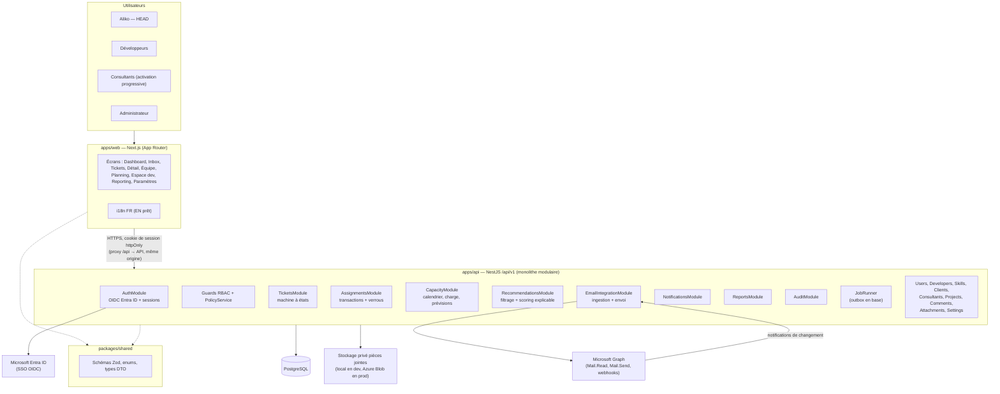
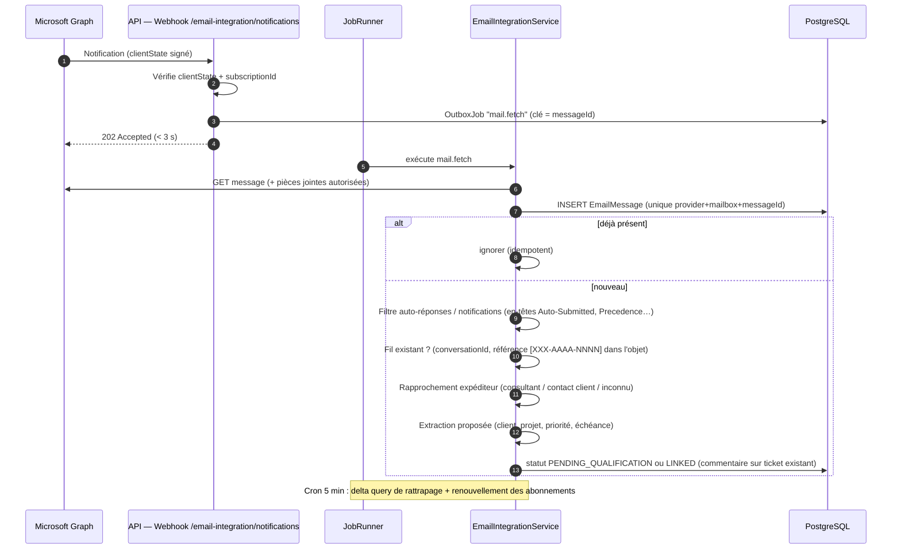

# Architecture technique — DevCapacity Manager

> Livrable **Phase 1 — Cadrage et conception** · Version 0.1 (proposition à valider)
> Référence : [cahier-des-charges.md](./cahier-des-charges.md)
> Documents liés : [data-model.md](./data-model.md) · [business-rules.md](./business-rules.md) · [backlog.md](./backlog.md)

---

## 1. Synthèse

DevCapacity Manager est un **monolithe modulaire** composé de :

- un **frontend Next.js** (App Router, TypeScript strict, Tailwind, shadcn/ui) ;
- une **API NestJS** (`/api/v1`) qui détient **toutes** les règles métier (workflow, capacité, recommandation, permissions) ;
- une base **PostgreSQL** pilotée par **Prisma** (migrations versionnées) ;
- un **connecteur Microsoft Graph** (Outlook / Microsoft 365) pour la boîte d'Aliko, derrière une interface `MailProvider` indépendante du fournisseur ;
- une **file de tâches persistée en base** (pattern *outbox*) pour les e-mails sortants, notifications et synchronisations — remplaçable par BullMQ/Redis plus tard sans changer le domaine.

Contexte confirmé : toute l'équipe est sur **Outlook / Microsoft 365**, identités `prenom.nom@safirconsulting.net`, **Aliko est le point central** (reçoit des consultants internes et de clients externes, y compris avec adresses personnelles, et affecte les tâches par e-mail).

---

## 2. Diagramme de composants



---

## 3. Décisions d'architecture (ADR résumées)

| # | Décision | Justification | Alternatives écartées |
|---|---|---|---|
| ADR-01 | **Monolithe modulaire** NestJS + Next.js dans un monorepo **npm workspaces** | 1 équipe, ~10 utilisateurs internes : simplicité de déploiement et de debug. npm est déjà installé (pas de pnpm sur le poste) | Microservices (complexité injustifiée), Turborepo/Nx (inutiles à ce stade) |
| ADR-02 | **Le backend est l'unique autorité** métier ; le front n'affiche que des résultats calculés par l'API | Exigence §11 et §21 : pas de duplication des calculs, pas de confiance au navigateur | Calculs côté client |
| ADR-03 | **Proxy same-origin** : Next.js réécrit `/api/*` vers NestJS | Cookie de session `httpOnly; Secure; SameSite=Lax` sans CORS ni token exposé au JS | JWT en localStorage (vulnérable XSS) |
| ADR-04 | **SSO Microsoft Entra ID (OIDC, Authorization Code + PKCE)** géré par l'API ; **sessions serveur** stockées en base | Identités M365 existantes, révocation immédiate possible, aucun mot de passe stocké pour l'équipe | JWT stateless (révocation difficile) |
| ADR-05 | **Authentification locale de repli** (argon2id) **désactivée par défaut en production** | Permet de développer et tester avant l'accès admin Entra ID | — |
| ADR-06 | **RBAC + politiques au niveau ressource** (`PolicyService`) | Ex. un DEVELOPER ne modifie que *ses* affectations ; un CONSULTANT ne voit que *ses* tickets et commentaires `CONSULTANT` | RBAC simple par route (insuffisant) |
| ADR-07 | **Capacité calculée à la volée** depuis : horaires, jours fériés, indisponibilités, affectations (heures restantes). **Aucune table de charge dénormalisée** en V1 | Une seule source de vérité, pas de double comptage (§8.1). Volume faible (≈10 devs × 90 jours) | Matérialiser la charge journalière (à envisager si besoin de perf, documenté) |
| ADR-08 | **Affectation transactionnelle avec verrou par développeur** (`SELECT … FOR UPDATE` sur `DeveloperProfile`) puis re-vérification de la capacité dans la transaction | Empêche deux affectations concurrentes de consommer la même capacité (E2E-12) | Verrou optimiste seul |
| ADR-09 | **Moteur de recommandation déterministe** : filtrage puis score /100 avec sous-scores et justification textuelle stockée (snapshot) | Explicabilité et traçabilité des dérogations (§9) | ML / IA (non explicable, interdit pour l'affectation) |
| ADR-10 | **`MailProvider`** (interface) + **`GraphMailProvider`** seul implémenté en V1 | Outlook confirmé ; Gmail ajoutable sans toucher au domaine | Couplage direct à Graph |
| ADR-11 | **Ingestion Graph = webhooks + delta query de rattrapage** (cron 5 min) + renouvellement des abonnements | Les notifications Graph peuvent être perdues ; la delta query garantit la complétude | Polling seul (latence), webhooks seuls (perte possible) |
| ADR-12 | **Outbox en base** (`OutboxJob`) avec **clé d'idempotence unique**, exécutée par un `JobRunner` in-process (`@nestjs/schedule`) | Pas de Redis requis en V1 ; garantit « pas de double envoi » ; migrable vers BullMQ | BullMQ + Redis dès la V1 (infra supplémentaire) |
| ADR-13 | **Stockage pièces jointes** via interface `StorageProvider` : disque privé en dev, Azure Blob en prod | Cohérent avec l'écosystème Microsoft ; aucun fichier servi en accès direct | Stockage en base (volumétrie) |
| ADR-14 | **Validation partagée Zod** (`packages/shared`) côté front ; côté API, DTO validés par **pipe Zod** | Un seul schéma par contrat, pas de divergence | class-validator + Zod en double |
| ADR-15 | **Références lisibles** `PREFIXE-AAAA-NNNN` via table `TicketSequence` incrémentée dans la transaction de création | Unicité garantie, séquence annuelle par type (B11) | Séquence globale non lisible |
| ADR-16 | **Tests** : Jest (unitaires + intégration API sur base PostgreSQL de test), Playwright (E2E) | Outils standard de l'écosystème Nest/Next | — |
| ADR-17 | **i18n** : dictionnaires FR, structure prête pour EN (`next-intl`) | Exigence §16 | Textes en dur |
| ADR-18 | **Dates** stockées en UTC (`timestamptz`), jours de planning en `date`, affichage dans le fuseau de l'utilisateur | Exigence §16 ; équipe potentiellement multi-fuseaux | — |

---

## 4. Modules backend et responsabilités

| Module | Responsabilité | Dépend de |
|---|---|---|
| `AuthModule` | OIDC Entra ID, login local de repli, sessions, CSRF | Users, Audit |
| `UsersModule` | Comptes, rôles, invitations, domaines autorisés | Audit |
| `DevelopersModule` | Profils, horaires hebdomadaires, statut | Users, Skills |
| `SkillsModule` | Catalogue, catégories, niveaux, `DeveloperSkill` | — |
| `ClientsModule` | Clients + `ClientContact` (adresses pro/perso validées) | — |
| `ConsultantsModule` | Consultants internes/externes | Users |
| `ProjectsModule` | Projets par client | Clients |
| `TicketsModule` | CRUD, qualification, **machine à états**, dépendances, critères, blocages, historique | Skills, Clients, Projects, Audit |
| `AssignmentsModule` | Confirmation/réaffectation/libération **transactionnelles**, temps passé, reste à faire | Tickets, Capacity, Notifications, Audit |
| `CapacityModule` | Calendrier de travail, capacité nette/libre, charge, prévision de disponibilité, fiabilité, conflits | Developers, Availability |
| `RecommendationsModule` | Filtrage d'admissibilité, scoring, explications, snapshots | Capacity, Skills, Tickets |
| `EmailIntegrationModule` | `MailProvider`, ingestion, déduplication, fils, rapprochement expéditeurs, e-mails d'affectation, détection des envois depuis Outlook | Tickets, Clients, Consultants, Attachments, Jobs |
| `AttachmentsModule` | Upload, contrôles (type, taille, nom), `StorageProvider`, statut antivirus | — |
| `CommentsModule` | Commentaires `INTERNAL` / `CONSULTANT` | Tickets |
| `NotificationsModule` | In-app + e-mail (via outbox), idempotence | Jobs |
| `ReportsModule` | KPI dashboard, rapports filtrables, explications des indicateurs | Capacity, Tickets |
| `AuditModule` | Journal d'audit append-only, métadonnées minimales | — |
| `SettingsModule` | Pondérations, seuils, types, priorités, domaines publics, nom du produit | Audit |
| `JobsModule` *(technique)* | `OutboxJob`, `JobRunner`, reprises, back-off | — |

Structure interne de chaque module :

```text
tickets/
├── tickets.controller.ts        # HTTP uniquement (pas de logique métier)
├── tickets.service.ts           # cas d'usage
├── domain/
│   ├── ticket-state-machine.ts  # règles pures, testées unitairement
│   └── ticket-reference.ts
├── dto/                         # schémas Zod importés de packages/shared
├── tickets.repository.ts        # accès Prisma lorsque utile
└── tests/
```

---

## 5. Workflows métier principaux

### 5.1. E-mail entrant → demande à qualifier



### 5.2. Qualification → recommandation → affectation → e-mail au développeur

```mermaid
sequenceDiagram
    autonumber
    actor A as Aliko (HEAD)
    participant API as API
    participant R as RecommendationsService
    participant C as CapacityService
    participant DB as PostgreSQL
    participant J as JobRunner
    participant G as Microsoft Graph
    actor D as Développeur
    A->>API: Créer ticket depuis e-mail (TO_QUALIFY)
    A->>API: Compléter (type, client, compétences, estimation, critères) → READY
    A->>API: GET /tickets/:id/recommendations
    API->>R: recommander(ticket)
    R->>C: capacité libre par dev sur la fenêtre de réalisation
    R-->>A: candidats admissibles + scores détaillés + exclus avec motifs
    A->>API: POST /assignments (dev, heures, dates, [motif si dérogation], note e-mail)
    API->>DB: BEGIN ; SELECT DeveloperProfile FOR UPDATE
    API->>C: re-vérifier capacité (dans la transaction)
    API->>DB: INSERT Assignment + snapshot recommandation ; ticket → ASSIGNED
    API->>DB: INSERT Notification + OutboxJob "mail.send.assignment" (clé idempotente) + AuditLog
    API->>DB: COMMIT
    J->>G: sendMail depuis la boîte d'Aliko, objet "[ADD-2026-0001] Affectation — …"
    G-->>D: E-mail Outlook
    D->>API: Se connecte (SSO), passe le ticket IN_PROGRESS, saisit temps / reste à faire
```

### 5.3. Envoi direct depuis Outlook (hors plateforme)

Le connecteur surveille aussi le dossier **Éléments envoyés** d'Aliko. Si un message envoyé a pour destinataire un développeur actif et est rattachable à un ticket (fil ou référence), une **proposition d'affectation** est créée et affichée dans l'Inbox. Rien n'est réservé tant qu'Aliko n'a pas confirmé (même transaction que 5.2).

### 5.4. Cycle de vie du ticket

Machine à états et matrice de transitions : voir [business-rules.md §1](./business-rules.md#1-machine-à-états-des-tickets).

---

## 6. Sécurité (vue d'architecture)

| Sujet | Mesure |
|---|---|
| Authentification | OIDC Entra ID (PKCE, `state`, `nonce`), restriction au tenant Safir et aux comptes invités ; repli local argon2id désactivé en prod |
| Sessions | Table `Session`, cookie `httpOnly; Secure; SameSite=Lax`, rotation à la connexion, expiration glissante (8 h) + absolue (7 j) |
| CSRF | Double-submit token sur méthodes non sûres |
| Autorisation | Guard de rôle global + `PolicyService` par ressource ; refus par défaut |
| Entrées | Pipes Zod stricts (rejet des champs inconnus), Prisma (requêtes paramétrées) |
| Webhooks Graph | `clientState` secret aléatoire vérifié, validation du `validationToken`, `subscriptionId` connu ; le webhook ne fait **que** mettre en file — le contenu est toujours relu via Graph |
| Secrets | Variables d'environnement / coffre (Azure Key Vault en prod) ; jamais en base ni en logs ; tokens Graph chiffrés (AES-256-GCM) si stockés |
| Pièces jointes | Liste blanche de types, taille max (25 Mo par défaut), nom normalisé, stockage privé, téléchargement via API autorisée, `scanStatus` |
| Rate limiting | `@nestjs/throttler` sur auth et webhooks |
| Audit | `AuditLog` append-only pour toute action sensible (affectation, dérogation, changement de rôle, paramètres) |
| Contenu e-mail | Données non fiables : HTML assaini à l'affichage, jamais exécuté ; aucune IA décisionnelle |

---

## 7. Structure du dépôt (cible phase 2)

```text
gestion des tickets/              # racine du dépôt (devcapacity-manager)
├── apps/
│   ├── api/                      # NestJS
│   │   ├── prisma/
│   │   │   ├── schema.prisma
│   │   │   ├── migrations/
│   │   │   └── seed.ts           # référentiels + données fictives (@example.test) en dev uniquement
│   │   ├── src/
│   │   │   ├── main.ts
│   │   │   ├── app.module.ts
│   │   │   ├── common/           # guards, pipes, filtres d'erreurs, prisma.service
│   │   │   └── modules/          # auth, users, tickets, capacity, recommendations, email-integration…
│   │   └── test/                 # intégration (base de test)
│   └── web/                      # Next.js
│       ├── src/app/              # routes App Router
│       ├── src/components/
│       ├── src/lib/              # client API, formatage dates
│       └── messages/fr.json
├── packages/
│   └── shared/                   # schémas Zod, enums, types DTO
├── e2e/                          # Playwright
├── docs/
├── .env.example
├── docker-compose.yml            # PostgreSQL (+ Redis plus tard)
├── package.json                  # npm workspaces
└── README.md
```

---

## 8. Environnements et exploitation

| Environnement | Base | Mail | Auth |
|---|---|---|---|
| Local dev | PostgreSQL local (Docker ou installation native — voir risque R1) | `GraphMailProvider` désactivé, **aucun faux connecteur présenté comme réel** ; import manuel `.eml` pour tests | Login local + SSO si app Entra de dev disponible |
| Test / CI | PostgreSQL éphémère | Adaptateur de test (tests uniquement) | Sessions de test |
| Production | PostgreSQL managé (ex. Azure Database for PostgreSQL) + sauvegardes PITR | Graph (boîte d'Aliko) | SSO Entra ID uniquement |

Sauvegarde/restauration : `pg_dump` quotidien chiffré + rétention 30 j (dev/on-prem), ou PITR managé ; procédure détaillée en phase 7 (`docs/deployment.md`).

---

## 9. Risques et points restant à confirmer

| # | Risque / point | Impact | Mitigation |
|---|---|---|---|
| R1 | **Ni Docker ni PostgreSQL** installés sur le poste de développement | Bloquant pour la phase 2 | Installer **Docker Desktop** (recommandé) **ou** PostgreSQL 16 natif pour Windows — décision à prendre |
| R2 | Accès **administrateur Entra ID** non encore obtenu (app registration, `Mail.Read`, `Mail.Send`, consentement, Application Access Policy) | Bloque SSO et phase 5 | Démarrer avec login local ; envoyer la demande au service IT dès maintenant (liste dans le cahier §5) |
| R3 | URL **publique HTTPS** nécessaire pour les webhooks Graph | Phase 5 | En dev : delta query seule ; en prod : URL de l'hébergement |
| R4 | **Compétences réelles** des 8 développeurs inconnues | Recommandations non pertinentes | Saisie/validation des compétences avant mise en service ; le moteur affiche « données insuffisantes » |
| R5 | Qualité des **estimations** et des **mises à jour du reste à faire** | Prévisions peu fiables | Indicateur de fiabilité (§8.3), rappels aux développeurs, historique des réestimations |
| R6 | Adoption : Aliko continue de travailler depuis Outlook | Capacité faussée | Détection des envois (5.3) + e-mails d'affectation générés par la plateforme |
| R7 | **Usurpation** d'adresses personnelles clientes | Fausses demandes | Indicateur de vigilance, rapprochement par adresse exacte validée, aucune action automatique |
| R8 | Hébergement de production sur serveur SAP (B1 ou S/4HANA) | Risque de conflits de ports et interférence OS | **Conteneurisation Docker / Podman étanche** avec base PostgreSQL 16 dédiée, ports configurables (aucun conflit avec ports HANA 3xx15 ou Service Layer 50000/50001) |
| R9 | Jours fériés et fuseau de référence (B4) | Calcul de capacité | Table `PublicHoliday` configurable ; fuseau par développeur |

---

## 10. Validation attendue

Avant la phase 2, merci de valider :

1. Les décisions ADR-01 à ADR-18 (en particulier **outbox en base au lieu de Redis** en V1, ADR-12).
2. Les règles de calcul et de scoring de [business-rules.md](./business-rules.md).
3. Le modèle de données de [data-model.md](./data-model.md).
4. Le choix pour **R1** : Docker Desktop ou PostgreSQL natif.
