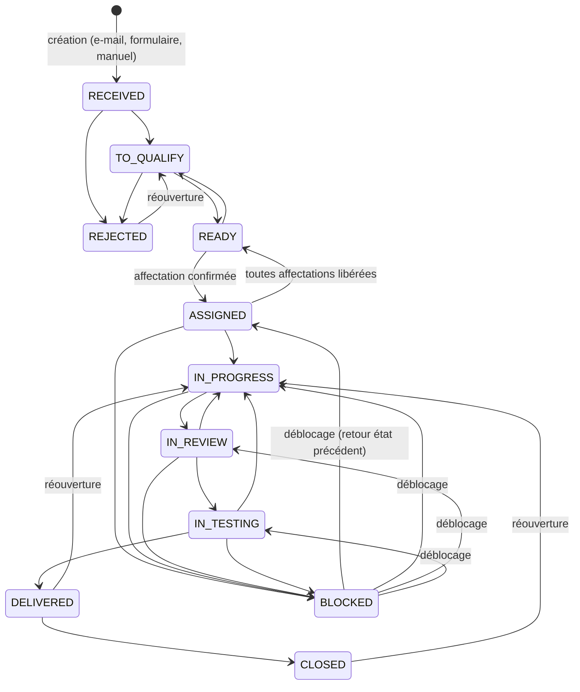

# Règles métier — DevCapacity Manager

> Livrable **Phase 1** · Version 0.1 (proposition à valider)
> Ces règles sont implémentées **uniquement côté API** (fonctions pures testées unitairement). Tous les seuils marqués ⚙️ sont des **paramètres** modifiables par le HEAD dans l'écran Paramètres.

---

## 1. Machine à états des tickets

### 1.1. Diagramme



### 1.2. Matrice des transitions

« Dév. affecté » = développeur ayant une affectation **active** sur le ticket.

| De | Vers | Rôles habilités | Conditions / effets |
|---|---|---|---|
| RECEIVED | TO_QUALIFY | HEAD, système | Automatique à la création d'une demande depuis l'Inbox |
| RECEIVED, TO_QUALIFY | REJECTED | HEAD | **Motif obligatoire** |
| TO_QUALIFY | READY | HEAD | **Critères de qualification** (§1.3) satisfaits |
| READY | TO_QUALIFY | HEAD | Motif conseillé |
| READY | ASSIGNED | HEAD (via `POST /assignments` uniquement) | Transition **jamais** directe : effectuée par la transaction d'affectation (§4) |
| ASSIGNED | READY | HEAD | Effet automatique quand la dernière affectation active est libérée |
| ASSIGNED | IN_PROGRESS | Dév. affecté, HEAD | Renseigne `startedAt` si vide |
| IN_PROGRESS | IN_REVIEW | Dév. affecté, HEAD | Reste à faire mis à jour (peut être 0) |
| IN_REVIEW | IN_PROGRESS / IN_TESTING | Dév. affecté, HEAD | — |
| IN_TESTING | IN_PROGRESS / DELIVERED | Dév. affecté, HEAD | DELIVERED : `deliveredAt` renseigné, reste à faire = 0, capacité libérée |
| DELIVERED | CLOSED | HEAD | Tous les critères d'acceptation **validés** (⚙️ `requireAcceptanceBeforeClose`, défaut : oui) |
| ASSIGNED, IN_PROGRESS, IN_REVIEW, IN_TESTING | BLOCKED | Dév. affecté, HEAD | **Motif obligatoire** → ouvre un `TicketBlocker` ; mémorise l'état précédent |
| BLOCKED | état précédent | Dév. affecté, HEAD | Clôt le `TicketBlocker` (`resolvedAt`) ; la durée de blocage est calculée |
| DELIVERED, CLOSED | IN_PROGRESS | HEAD | **Réouverture** : motif obligatoire, historique conservé, nouvelle estimation du reste à faire exigée |
| REJECTED | TO_QUALIFY | HEAD | Réouverture, motif obligatoire |

Toute transition crée une ligne `TicketStatusHistory` et une entrée `AuditLog`. Toute transition non listée est **refusée** (HTTP 409 `INVALID_TRANSITION`).

### 1.3. Critères de qualification (TO_QUALIFY → READY)

- titre (≥ 5 caractères) et description (≥ ⚙️ 30 caractères) ;
- type, priorité, client renseignés (projet facultatif) ;
- estimation initiale > 0 h ;
- au moins **une compétence requise** ;
- au moins un critère d'acceptation si le type l'exige (⚙️ par type ; défaut : Addon, Évolution fonctionnelle, Développement spécifique, Intégration).

L'API renvoie la liste exhaustive des critères manquants (HTTP 422).

### 1.4. Statuts qui réservent de la capacité

| Statut du ticket | Les affectations actives consomment-elles de la capacité ? |
|---|---|
| ASSIGNED, IN_PROGRESS, IN_REVIEW, IN_TESTING | Oui |
| BLOCKED | Oui (⚙️ `blockedReservesCapacity`, défaut : oui — le travail reste dû) |
| DELIVERED, CLOSED, REJECTED | Non (affectations passées à `COMPLETED` / `RELEASED`) |

---

## 2. Calendrier et capacité

### 2.1. Capacité planifiée d'un jour

Pour un développeur `d` et un jour `j` :

```text
planned(d, j) = weeklySchedule[d][jourSemaine(j)]        // heures, ex. lun–ven 8 h, sam–dim 0 h
              × planningFactor[d]                        // ⚙️ part planifiable, défaut 1.0 (ex. 0.8 si 20 % réservés)
              si j n'est pas un jour férié, sinon 0
```

- `weeklySchedule` : horaires par jour de semaine stockés dans le profil (défaut B3 : 8 h lun–ven).
- `planningFactor` couvre les activités récurrentes non suivies individuellement (réunions, support…). **Si une activité est saisie en `Availability` de type `RESERVED_ACTIVITY`, elle n'est pas aussi couverte par `planningFactor`** : le HEAD choisit l'une ou l'autre méthode par développeur (contrôle anti double comptage).

### 2.2. Indisponibilités

```text
unavailable(d, j) = min( planned(d, j), Σ heures d'indisponibilité APPROUVÉES qui chevauchent j )
```

- Une absence d'une journée entière = `planned(d, j)` (et non 8 h fixes) → pas de déduction au-delà de la capacité.
- Chevauchements entre plusieurs indisponibilités : **union des intervalles**, pas de somme brute.
- Les demandes `REQUESTED` (non approuvées) sont affichées mais ne sont pas déduites (⚙️).

### 2.3. Capacité nette et libre

```text
net(d, j)  = planned(d, j) − unavailable(d, j)
load(d, j) = Σ charge journalière des affectations actives de d sur j       (§2.4)
free(d, j) = net(d, j) − load(d, j)          // peut être négatif ⇒ surcharge

Sur une période P :
Capacité nette(P) = Σ net(d, j)
Capacité libre(P) = Σ free(d, j)
Taux de charge(P) = Σ load / Σ net
```

### 2.4. Charge restante d'une affectation et répartition

```text
remaining(a) = remainingHours déclaré sur l'affectation              si renseigné
             = max(0, allocatedHours − Σ TimeEntry(a))               sinon (règle explicite de repli)
```

Répartition (V1) : `remaining(a)` est **réparti au prorata de la capacité nette** sur les jours ouvrés de l'intervalle `[max(aujourd'hui, plannedStart), plannedEnd]`.

- Si `plannedEnd` est dépassée et `remaining > 0` : la charge est reportée sur les jours suivants en mode « au plus tôt » et l'affectation est signalée **en retard**.
- Le pourcentage d'avancement n'est **pas** utilisé pour calculer la charge (§10 du cahier).

### 2.5. Surcharge et conflits

| Signal | Règle |
|---|---|
| Jour en surcharge | `load(d, j) > net(d, j) × ⚙️ overloadTolerance` (défaut 1.0) |
| Semaine surchargée | taux de charge hebdomadaire > ⚙️ 100 % |
| Conflit de planning | affectation dont l'intervalle chevauche une indisponibilité approuvée réduisant la capacité sous la charge prévue |
| Affectation à risque | date de fin estimée (§3) > échéance validée du ticket |

### 2.6. Prévision de disponibilité

```text
nextAvailableDate(d) = premier jour ouvré j ≥ aujourd'hui tel que
                       free(d, j) ≥ net(d, j) × ⚙️ availabilityThreshold   (défaut 50 %)
                       pendant ⚙️ 2 jours ouvrés consécutifs
```

Horizon de calcul ⚙️ 90 jours ; au-delà : « > 90 j ».

### 2.7. Indicateur de fiabilité des données

Pour chaque développeur, la fiabilité est **Insuffisante** si au moins une condition est vraie, **Partielle** si une condition « attention » est vraie, sinon **Bonne** :

| Condition | Niveau |
|---|---|
| Aucun horaire de travail défini | Insuffisante |
| Affectation active sans reste à faire ni heures allouées | Insuffisante |
| Reste à faire non mis à jour depuis > ⚙️ 7 jours sur un ticket IN_PROGRESS | Partielle |
| Temps passé > estimation initiale × 1.5 sans réestimation | Partielle |

Avec une fiabilité **Insuffisante**, l'écran affiche « Prévision non fiable » à la place d'une date.

---

## 3. Date de fin estimée d'un nouveau travail (simulation)

Pour un ticket nécessitant `H` heures et un développeur `d` :

```text
start = max(aujourd'hui, ticket.plannedStartDate, date de fin des dépendances bloquantes)
cumul = 0 ; j = start
tant que cumul < H et j ≤ horizon :
    cumul += max(0, free(d, j)) × ⚙️ focusFactor        // défaut 1.0
    j = jour ouvré suivant
estimatedFinish(d) = dernier jour ayant contribué      (ou « hors horizon »)
```

`H` = estimation restante du ticket (ou, si plusieurs développeurs, les heures proposées pour ce développeur).

---

## 4. Affectation : transaction et contrôles

`POST /api/v1/assignments` exécute **dans une seule transaction** :

1. `SELECT … FROM "DeveloperProfile" WHERE id = $dev FOR UPDATE` (verrou par développeur, ordre des verrous par id si plusieurs devs).
2. Recharge du ticket : statut ∈ {READY, ASSIGNED, IN_PROGRESS, BLOCKED…} (co-affectation autorisée), sinon 409.
3. Recalcul de la capacité libre de `d` sur `[plannedStart, plannedEnd]` **avec les données lues dans la transaction**.
4. Si `allocatedHours > capacité libre` ou compétence obligatoire manquante ou candidat non recommandé : refus 409 `CAPACITY_EXCEEDED` / `NOT_ELIGIBLE` **sauf** si `override = true` + `overrideReason` (≥ 10 caractères) par un HEAD.
5. INSERT `Assignment` (+ `recommendationSnapshot` JSON : scores et rang au moment de la décision).
6. Ticket → ASSIGNED si READY ; `TicketStatusHistory`.
7. INSERT `Notification` + `OutboxJob` (`mail.send.assignment`, clé `assignment:{id}:created`).
8. INSERT `AuditLog` (`ASSIGNMENT_CREATED` ou `ASSIGNMENT_OVERRIDE`).

Isolation : `READ COMMITTED` + verrou explicite suffit (toutes les écritures concurrentes sur un même développeur sont sérialisées). Test E2E-12 : deux requêtes simultanées consommant chacune 60 % de la capacité → une seule réussit, l'autre reçoit 409.

Réaffectation = libération (`RELEASED`, `releasedAt`, motif) de l'ancienne affectation + nouvelle affectation, dans la même transaction.

---

## 5. Moteur de recommandation

### 5.1. Fenêtre de réalisation

```text
windowStart = max(aujourd'hui, ticket.plannedStartDate)
windowEnd   = ticket.committedDueDate ?? ticket.requestedDueDate ?? windowStart + ⚙️ 20 jours ouvrés
H           = ticket.remainingEstimatedHours ?? ticket.estimatedHours
```

### 5.2. Étape 1 — Filtrage (motif d'exclusion affiché pour chaque exclu)

| Code | Exclusion si |
|---|---|
| `MISSING_MANDATORY_SKILL` | ∃ compétence obligatoire avec niveau du dev < `minimumLevel` (ou absente) |
| `INACTIVE` | profil non actif |
| `INSUFFICIENT_CAPACITY` | `Σ free(d, j)` sur la fenêtre < `H` |
| `DEADLINE_UNREACHABLE` | `estimatedFinish(d)` > `windowEnd` (si échéance fournie) |
| `UNAVAILABLE` | indisponible sur ≥ ⚙️ 80 % des jours ouvrés de la fenêtre |
| `BUSINESS_CONSTRAINT` | exclusion explicite (ex. dev exclu d'un client/ticket par le HEAD) |
| `UNRELIABLE_DATA` | *non excluant* : avertissement affiché si fiabilité Insuffisante |

Si **aucun** candidat n'est admissible, l'API renvoie `candidates: []` et la liste des exclus avec motifs ; l'UI propose : revoir l'estimation, l'échéance, les compétences requises, ou affecter par dérogation motivée.

### 5.3. Étape 2 — Score /100 (pondérations ⚙️, somme = 100)

**a) Adéquation des compétences — 45 pts**

Pour chaque compétence requise `r` (poids `w_r` ⚙️ défaut 1, niveau min `m_r`, niveau du dev `l_r`, niveau max `L = 5`) :

```text
s_r = 0                                          si l_r < m_r   (possible seulement pour une compétence souhaitable)
s_r = 0.6 + 0.4 × (l_r − m_r) / (L − m_r)        sinon            (s_r = 1 si m_r = L)
Score compétences = 45 × Σ(w_r × s_r) / Σ w_r
```

Atteindre le minimum vaut 60 % de la note ; l'expertise au-delà apporte les 40 % restants.

**b) Capacité disponible — 30 pts**

```text
utilisationAprès = (Σ load + H) / Σ net       sur la fenêtre
Score capacité   = 30 × clamp(1 − utilisationAprès, 0, 1)
```

Formule linéaire : un développeur entièrement libre obtient ≈ 30, un développeur saturé après affectation obtient 0.

**c) Compatibilité avec l'échéance — 15 pts**

```text
marge = jours ouvrés entre estimatedFinish(d) et windowEnd
Score échéance = 15 × clamp(marge / ⚙️ margeCible (5 j), 0, 1)
Sans échéance : Score échéance = 15 × 0.8 = 12 (neutre, signalé « pas d'échéance »)
```

**d) Continuité / connaissance du projet — 10 pts**

| Situation | Points |
|---|---|
| Affectation active ou terminée < ⚙️ 180 j sur **le même projet** | 10 |
| Sinon, sur **le même client** | 6 |
| Sinon, ticket lié (dépendance) déjà traité par le dev | 4 |
| Aucun historique | 0 |

**Score global** = a + b + c + d (arrondi à l'entier). Égalité : départage par date de fin estimée la plus tôt, puis charge la plus faible, puis ordre alphabétique (déterminisme).

### 5.4. Sortie de l'API (extrait)

```json
{
  "ticketId": "…",
  "window": { "start": "2026-10-27", "end": "2026-11-14", "requiredHours": 24 },
  "weights": { "skills": 45, "capacity": 30, "deadline": 15, "continuity": 10 },
  "candidates": [
    {
      "developerId": "…", "name": "…", "rank": 1, "score": 82,
      "breakdown": { "skills": 39.6, "capacity": 21.0, "deadline": 15, "continuity": 6 },
      "matchedSkills": [{ "skill": "SAP ABAP", "required": 3, "actual": 4, "mandatory": true }],
      "currentLoadRate": 0.42, "freeHoursInWindow": 61.5,
      "estimatedFinish": "2026-11-04", "nextAvailableDate": "2026-10-29",
      "reliability": "GOOD", "risks": [], "conflicts": []
    }
  ],
  "excluded": [{ "developerId": "…", "name": "…", "reasons": ["MISSING_MANDATORY_SKILL"] }]
}
```

Le priorité métier **n'entre pas** dans le score (§6.4 du cahier) ; elle sert au tri des files de travail et au calcul des risques.

---

## 6. E-mails

### 6.1. Déduplication

1. Clé unique `(provider, mailboxReference, providerMessageId)` → un message ne peut être inséré deux fois.
2. Clé secondaire `internetMessageId` (en-tête RFC 5322) → détecte un même message reçu par deux chemins (ex. copie).
3. Doublon probable (non bloquant, signalé) : même expéditeur + objet normalisé (sans `RE:`, `TR:`, `FW:`) + < ⚙️ 72 h.

### 6.2. Messages ne devant pas créer de demande

Ignorés automatiquement (statut `IGNORED`, consultables) : en-têtes `Auto-Submitted: auto-*`, `Precedence: bulk|list|junk`, `X-Auto-Response-Suppress`, accusés de lecture, NDR (`mailer-daemon`, `postmaster`), réponses à des e-mails d'affectation (rattachées au ticket comme commentaire).

### 6.3. Rattachement à un ticket existant

Ordre : (1) référence `[XXX-AAAA-NNNN]` dans l'objet ; (2) `conversationId` Graph déjà lié ; (3) en-têtes `In-Reply-To` / `References`. Sinon : nouvelle demande.

### 6.4. Rapprochement de l'expéditeur

| Ordre | Règle | Résultat |
|---|---|---|
| 1 | Adresse = utilisateur interne actif (développeur) | `INTERNAL_TEAM` |
| 2 | Adresse = consultant enregistré | `INTERNAL_CONSULTANT` / consultant externe |
| 3 | Adresse = `ClientContact` validé | `CLIENT_CONTACT` + client pré-rempli |
| 4 | Domaine non public = domaine d'un client connu | `UNKNOWN` + **client proposé** |
| 5 | Sinon (dont domaines publics ⚙️ gmail.com, yahoo.*, outlook.com, hotmail.*, live.*, icloud.com…) | `UNKNOWN` (« expéditeur non identifié ») |

Adresses personnelles : drapeau de vigilance affiché.

### 6.5. Extraction proposée (déterministe, V1)

- Priorité : mots-clés explicites (⚙️ « urgent », « bloquant », « critique » → Critical/High proposés).
- Échéance : dates explicites précédées de « avant le », « pour le », « d'ici le », « deadline ».
- Client/projet : via l'expéditeur (§6.4) et références de projet connues présentes dans l'objet.
- Tout champ extrait est marqué **« proposé »** jusqu'à validation par le HEAD.

---

## 7. Permissions détaillées (extrait des politiques ressource)

| Ressource / action | HEAD | DEVELOPER | CONSULTANT | ADMIN |
|---|---|---|---|---|
| `ticket.read` | tous | tickets où il a une affectation (active ou passée) | tickets dont il est le demandeur | — |
| `ticket.create` / `qualify` / `reprioritize` | ✅ | ❌ | `create` via formulaire si ⚙️ activé (statut RECEIVED) | ❌ |
| `ticket.transition` | ✅ (matrice §1.2) | ses tickets (matrice §1.2) | ❌ | ❌ |
| `assignment.create` / `release` / `override` | ✅ | ❌ (**jamais d'auto-affectation**) | ❌ | ❌ |
| `assignment.updateProgress` / `timeEntry.create` | ✅ | ses affectations | ❌ | ❌ |
| `comment.read` | tous | `INTERNAL` + `CONSULTANT` de ses tickets | `CONSULTANT` de ses tickets | ❌ |
| `availability.create` | ✅ (tous) | les siennes (statut REQUESTED, ⚙️ auto-approuvé ou non) | ❌ | ❌ |
| `capacity.read` | équipe | la sienne | ❌ | ❌ |
| `email.read` / `qualify` | ✅ | ❌ | ❌ | ❌ |
| `email.configure` | ❌ | ❌ | ❌ | ✅ |
| `settings.business` (pondérations, seuils, types) | ✅ | ❌ | ❌ | ❌ |
| `users.manage` / `roles` | ❌ | ❌ | ❌ | ✅ |
| `audit.read` | métier | ❌ | ❌ | technique |

Un utilisateur peut cumuler plusieurs rôles (ex. HEAD + DEVELOPER) ; ses permissions sont l'union des rôles, **sauf** `assignment.create` sur soi-même qui reste soumis à la validation HEAD et tracé.
