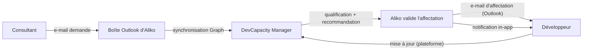
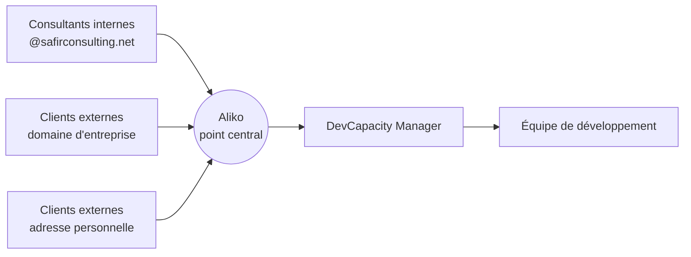
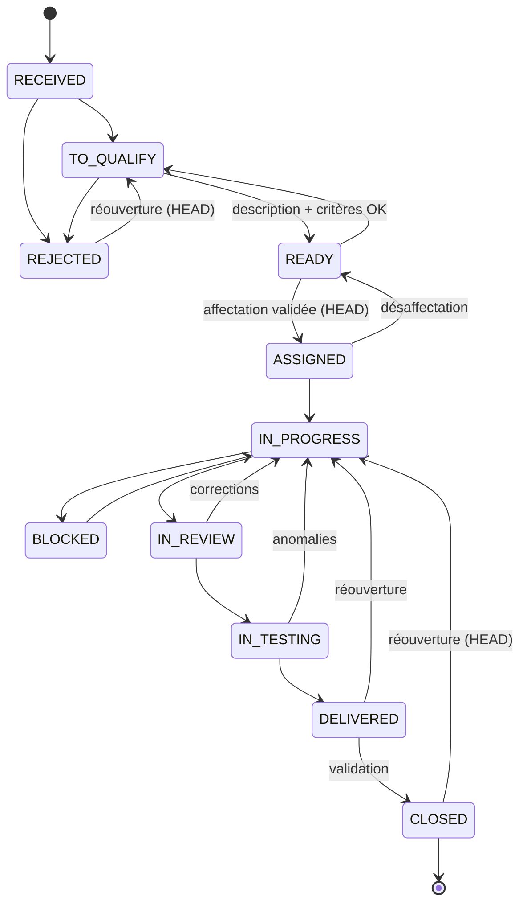
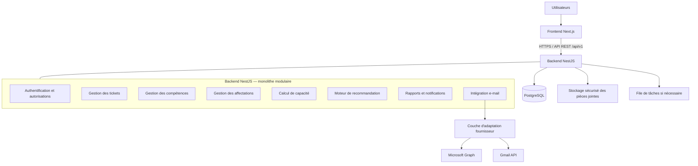
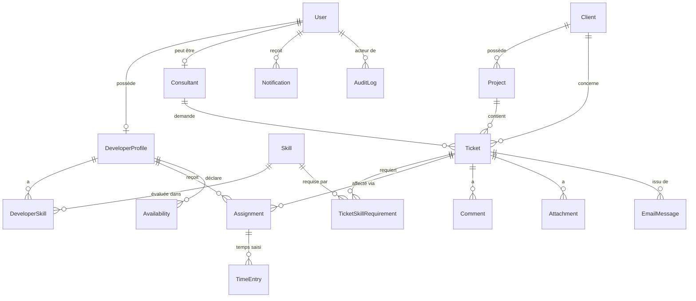

# Cahier des charges — DevCapacity Manager

> **Plateforme intelligente de gestion des tickets, des addons et des ressources de développement**
> Client : **Safir Consulting** — Équipe de développement SME Business Unit
> Statut du document : **Référence contractuelle du projet** (version 1.0)
> Nom de travail du produit : **DevCapacity Manager** (nom configurable, personnalisable selon l'identité visuelle de l'entreprise)

---

## Sommaire

- [0. Règles d'usage de ce document](#0-règles-dusage-de-ce-document)
- [1. Rôle et expertise attendus](#1-rôle-et-expertise-attendus)
- [2. Contexte métier](#2-contexte-métier)
- [3. Objectifs principaux](#3-objectifs-principaux)
- **Partie I — Architecture fonctionnelle**
  - [4. Utilisateurs et contrôle des accès](#4-utilisateurs-et-contrôle-des-accès-rbac)
  - [5. Module e-mails et demandes entrantes](#5-module-de-gestion-des-e-mails-et-des-demandes-entrantes)
  - [6. Module tickets et addons](#6-module-de-gestion-des-tickets-et-addons)
  - [7. Module développeurs et compétences](#7-module-de-gestion-des-développeurs-et-des-compétences)
  - [8. Module planification de la capacité](#8-module-de-planification-de-la-capacité)
  - [9. Moteur d'aide à l'affectation](#9-moteur-daide-à-laffectation)
  - [10. Suivi de la progression](#10-suivi-de-la-progression)
- **Partie II — Architecture technique**
  - [11. Stack technologique](#11-stack-technologique-recommandée)
  - [12. Architecture logicielle](#12-architecture-logicielle)
  - [13. Modèle de données](#13-modèle-de-données)
  - [14. API REST](#14-api-rest)
- **Partie III — Interface utilisateur**
  - [15. Écrans à développer](#15-écrans-à-développer)
  - [16. Design system et UX](#16-design-system-et-expérience-utilisateur)
- **Partie IV — Sécurité et fiabilité**
  - [17. Exigences de sécurité](#17-exigences-de-sécurité)
- **Partie V — Qualité logicielle**
  - [18. Tests obligatoires](#18-tests-obligatoires)
- **Partie VI — Organisation du projet**
  - [19. Structure du code](#19-structure-du-code)
  - [20. Plan de développement](#20-plan-de-développement)
- **Partie VII — Contraintes de développement**
  - [21. Règles à respecter](#21-règles-à-respecter)
- **Partie VIII — Livrables attendus**
  - [22. Livrables](#22-livrables-attendus)
- [23. Instruction finale et méthode de travail](#23-instruction-finale-et-méthode-de-travail)
- [Annexe A — Glossaire](#annexe-a--glossaire)
- [Annexe B — Points à confirmer](#annexe-b--points-à-confirmer)

---

## 0. Règles d'usage de ce document

- Ce document constitue la **source de vérité** fonctionnelle et technique du projet.
- Toute décision qui s'en écarte doit être **documentée** (ADR — Architecture Decision Record dans `docs/`), avec sa justification.
- Les exigences utilisent les conventions suivantes :
  - **DOIT / NE DOIT PAS** : exigence obligatoire.
  - **DEVRAIT** : recommandation forte, dérogation justifiée possible.
  - **PEUT** : option ou évolution.
- Lorsqu'une information secondaire manque, une **hypothèse raisonnable** est formulée, documentée (Annexe B) et le développement se poursuit. Le projet ne doit pas être bloqué par des détails non essentiels.

---

## 1. Rôle et expertise attendus

L'équipe de réalisation (humaine ou agent IA) agit en tant que **Senior Solution Architect, Software Engineering Lead et Full-Stack Developer**, spécialisé dans :

- les applications de gestion d'équipe ;
- les systèmes d'information d'entreprise ;
- les intégrations e-mail ;
- le resource planning ;
- les architectures logicielles sécurisées.

L'objectif est de concevoir et développer une **application web professionnelle, robuste, évolutive et maintenable**, destinée à une équipe de développement de Safir Consulting.

> [!IMPORTANT]
> Il ne s'agit **pas** d'une maquette visuelle. La solution doit être réellement fonctionnelle : architecture, modèle de données, backend, frontend, règles métier, sécurité, tests et documentation technique.

Avant de coder : analyser les exigences, identifier les ambiguïtés importantes et définir une architecture cohérente.

---

## 2. Contexte métier

### 2.1. Organisation

- L'application est destinée à une équipe de développement travaillant avec des **consultants** et des **entreprises clientes**.
- Le responsable est le **Head of SME Business Unit and Development Team**.
- Il supervise une équipe de **huit développeurs** (effectif initial), travaillant simultanément sur différents projets clients, avec des compétences techniques différentes.

### 2.2. Nature des demandes

Les consultants transmettent régulièrement, **par e-mail**, des demandes telles que :

- développement d'addons spécifiques pour un client ;
- ajout de fonctionnalités à une application existante ;
- corrections de bugs ;
- modifications ou personnalisations techniques ;
- intégrations entre systèmes ;
- développements spécifiques répondant à un besoin métier ;
- demandes d'analyse technique, de maintenance ou d'assistance.

Le responsable reçoit ces demandes dans sa boîte e-mail professionnelle, puis décide quel développeur doit prendre en charge chaque demande.

### 2.3. Problème à résoudre

Il n'existe pas aujourd'hui de **vision centralisée et fiable** de la charge de travail, des compétences, des disponibilités, des priorités et de la progression de chaque développeur.

### 2.4. Questions auxquelles l'application doit répondre rapidement

1. Quels tickets et addons viennent d'être reçus ?
2. Quelles demandes attendent encore une qualification ou une affectation ?
3. Sur quels projets travaille chaque développeur ?
4. Quelle est la charge de travail restante de chaque personne ?
5. Qui possède les compétences nécessaires pour traiter un ticket donné ?
6. Quel développeur peut prendre en charge une nouvelle demande sans compromettre ses engagements actuels ?
7. Quels tickets risquent d'être livrés en retard ?
8. Quels développeurs sont bloqués ou surchargés ?
9. Quand chaque développeur devrait-il pouvoir prendre un nouveau ticket ?
10. Quelle est la progression réelle des demandes et des projets ?

> [!NOTE]
> L'application **assiste** le responsable dans ses décisions mais lui laisse **le contrôle final** des affectations.

---

## 3. Objectifs principaux

Développer une plateforme interne permettant de :

| # | Objectif |
|---|----------|
| O1 | Centraliser les demandes provenant des e-mails |
| O2 | Transformer les demandes pertinentes en tickets exploitables |
| O3 | Gérer les clients, les consultants et les projets |
| O4 | Maintenir un référentiel structuré des compétences techniques |
| O5 | Calculer la capacité de travail disponible des développeurs |
| O6 | Suivre les charges sur plusieurs projets simultanés |
| O7 | Recommander le développeur le plus adapté à chaque demande |
| O8 | Permettre au responsable de valider ou modifier les recommandations |
| O9 | Suivre l'avancement, les estimations, les retards et les blocages |
| O10 | Conserver un historique complet des décisions et des modifications |
| O11 | Produire des indicateurs fiables pour le pilotage de l'équipe |

> [!IMPORTANT]
> La plateforme **ne doit pas être un simple clone de Jira ou de Trello**. Sa valeur principale réside dans la **gestion transversale de la capacité de développement** et dans **l'aide à la décision pour l'affectation des ressources**.

---

# PARTIE I — ARCHITECTURE FONCTIONNELLE

## 4. Utilisateurs et contrôle des accès (RBAC)

Implémenter un système de contrôle d'accès basé sur les rôles (**RBAC**), appliqué **côté serveur**.

### 4.1. Rôle : Head of SME Business Unit and Development Team (`HEAD`)

Responsable opérationnel de la plateforme. Il peut :

- accéder au tableau de bord global ;
- consulter les profils de tous les développeurs ;
- gérer les compétences et les niveaux d'expertise ;
- consulter les projets et les affectations ;
- consulter les demandes importées depuis la messagerie ;
- qualifier et prioriser les demandes ;
- créer, modifier et réaffecter des tickets ;
- valider les recommandations du moteur d'affectation ;
- définir les estimations et les échéances ;
- suivre les progrès et les blocages ;
- consulter les indicateurs et les rapports ;
- gérer les paramètres métier autorisés ;
- consulter l'historique des actions.

> [!WARNING]
> Le nombre de **huit développeurs ne doit pas être codé en dur**. Il s'agit de l'effectif initial ; le référentiel doit permettre d'ajouter ou de retirer des utilisateurs.

### 4.2. Rôle : Developer (`DEVELOPER`)

Chaque développeur dispose de son propre espace. Il peut :

- consulter ses tickets affectés ;
- consulter ses priorités et ses échéances ;
- mettre à jour le statut de ses tâches ;
- déclarer le pourcentage d'avancement ;
- enregistrer le temps passé ;
- actualiser le temps restant estimé ;
- déclarer un blocage ou une dépendance ;
- ajouter des commentaires techniques ;
- consulter son planning et sa charge ;
- déclarer ses indisponibilités selon les règles définies par l'entreprise ;
- consulter ses compétences enregistrées.

> [!CAUTION]
> Un développeur **ne doit pas pouvoir s'affecter lui-même** un ticket en contournant les règles de validation.

### 4.3. Rôle : Consultant (`CONSULTANT`)

Rôle disponible, à **activation progressive**. Il peut :

- soumettre une demande via un formulaire (si la fonctionnalité est activée) ;
- consulter les tickets auxquels il est autorisé à accéder ;
- ajouter des précisions ou des pièces jointes ;
- consulter les statuts et les commentaires qui lui sont destinés.

Il **ne doit pas** pouvoir consulter :

- les charges individuelles confidentielles ;
- les informations d'autres clients ;
- les commentaires internes non autorisés.

### 4.4. Rôle : Administrator (`ADMIN`)

L'administrateur technique gère :

- les comptes et les rôles ;
- les paramètres de sécurité ;
- les référentiels globaux ;
- les connexions aux services externes ;
- les paramètres de messagerie ;
- les journaux techniques et les paramètres de maintenance.

> [!NOTE]
> Séparer autant que possible les **privilèges d'administration technique** (ADMIN) des **privilèges métier** (HEAD).

### 4.5. Matrice synthétique des permissions

| Capacité | HEAD | DEVELOPER | CONSULTANT | ADMIN |
|---|:-:|:-:|:-:|:-:|
| Dashboard global | ✅ | ❌ | ❌ | ⚙️ technique |
| Voir tous les profils développeurs | ✅ | ❌ (le sien) | ❌ | ✅ (comptes) |
| Gérer compétences / niveaux | ✅ | 👁️ les siennes | ❌ | ❌ |
| Inbox e-mails / qualification | ✅ | ❌ | ❌ | ⚙️ config |
| Créer / modifier / réaffecter ticket | ✅ | ❌ | ➕ soumettre demande | ❌ |
| Valider une affectation | ✅ | ❌ | ❌ | ❌ |
| Mettre à jour statut / avancement / temps | ✅ | ✅ (ses tickets) | ❌ | ❌ |
| Déclarer blocage / indisponibilité | ✅ | ✅ (les siens) | ❌ | ❌ |
| Commentaires internes | ✅ | ✅ | ❌ | ❌ |
| Commentaires visibles consultant | ✅ | ✅ | ✅ (ses tickets) | ❌ |
| Rapports et indicateurs | ✅ | 👁️ personnels | ❌ | ❌ |
| Paramètres métier (pondérations, capacité) | ✅ | ❌ | ❌ | ❌ |
| Comptes, rôles, sécurité, intégrations | ❌ | ❌ | ❌ | ✅ |
| Journal d'audit | ✅ (métier) | ❌ | ❌ | ✅ (technique) |

### 4.6. Identité des utilisateurs : adresses e-mail professionnelles

> ✅ **Confirmé (26/10/2026)** : tous les membres de l'équipe disposent d'une **adresse e-mail professionnelle Microsoft 365** au format `prenom.nom@safirconsulting.net` (ex. `fatoumata.traore@safirconsulting.net`, `aliko.getheme@safirconsulting.net`).

Conséquences fonctionnelles et techniques :

- **Identifiant unique** : l'adresse professionnelle est l'identifiant de connexion et la clé de rapprochement de chaque utilisateur (`User.email`, unique, normalisé en minuscules).
- **Connexion SSO** : les membres de l'équipe se connectent avec leur **compte Microsoft d'entreprise (Entra ID)** ; l'identifiant Entra (`oid`) est stocké pour fiabiliser le rattachement même si l'adresse change.
- **Domaine autorisé** : l'accès interne (HEAD, DEVELOPER, ADMIN) est restreint au domaine **`safirconsulting.net`** (liste de domaines configurable). Un compte n'est actif que s'il a été **créé ou invité** dans la plateforme avec un rôle : appartenir au domaine ne suffit pas.
- **Rapprochement des e-mails** :
  - les **destinataires** des e-mails d'affectation envoyés par Aliko (§5.5) sont reconnus automatiquement comme développeurs grâce à leur adresse professionnelle ;
  - les **réponses** d'un développeur sont rattachées à son profil et au ticket ;
  - un expéditeur `@safirconsulting.net` non développeur (ex. consultant interne) est rapproché de la fiche **Consultant** correspondante ;
  - un expéditeur **externe** au domaine est traité comme un contact externe (client ou consultant externe) et soumis aux règles de prudence du §17.2 (cf. §5.6).
- **Pas de mot de passe stocké** pour les comptes SSO ; une authentification locale n'existe qu'en repli ou en environnement de développement.
- **Données de test** : les jeux de données fictifs utilisent un domaine réservé (ex. `@example.test`), jamais de vraies adresses de l'équipe.

---

## 5. Module de gestion des e-mails et des demandes entrantes

Composante **stratégique** de l'application.

- Adresse de réception du responsable : **aliko.getheme@safirconsulting.net**
- ✅ **Décision (26/10/2026)** : toute l'équipe utilise **Outlook (Microsoft 365)**. L'adaptateur **Microsoft Graph** est donc **prioritaire et seul implémenté en V1**.
- Le domaine métier reste toutefois **indépendant du fournisseur** (interface `MailProvider`), afin qu'un adaptateur **Google Workspace** puisse être ajouté ultérieurement sans refonte.

> [!IMPORTANT]
> Prérequis Microsoft 365 à obtenir auprès de l'administrateur du tenant Safir Consulting :
> - enregistrement d'une **application dans Microsoft Entra ID** (ex-Azure AD) ;
> - permissions Graph minimales (ex. `Mail.Read` / `Mail.ReadBasic` en délégué, ou permission applicative restreinte à la seule boîte concernée via une **Application Access Policy**) ;
> - permission **`Mail.Send`** pour l'envoi des e-mails d'affectation aux équipes (cf. §5.5), restreinte à la boîte d'Aliko et/ou à une boîte de service ;
> - **consentement administrateur** du tenant ;
> - URL publique HTTPS pour les **notifications de changement (webhooks Graph)**, ou à défaut synchronisation périodique par **delta query**.

### 5.1. Intégration à la messagerie

Prévoir :

- connexion **OAuth 2.0** au fournisseur autorisé ;
- **Microsoft Graph API** pour Microsoft 365, si applicable ;
- **Gmail API** pour Google Workspace, si applicable ;
- réception des nouveaux messages par **webhook** ou mécanisme de synchronisation adapté ;
- **renouvellement et validation des abonnements** aux notifications lorsque le fournisseur l'exige ;
- **mécanisme de reprise périodique** en cas de perte d'une notification ;
- conservation de l'**identifiant du message** et de celui du **fil de discussion** ;
- synchronisation contrôlée des **pièces jointes** ;
- gestion des **erreurs, quotas et limitations API**.

> [!CAUTION]
> - Ne **jamais** demander à l'utilisateur le mot de passe de sa messagerie. Utiliser exclusivement les mécanismes d'authentification autorisés par l'entreprise.
> - Ne **pas présumer** que l'accès à la boîte de réception est déjà autorisé. Prévoir la configuration des permissions, le consentement requis et la validation par l'administrateur de l'organisation.

### 5.2. Traitement d'un e-mail entrant

À la réception d'un message :

1. Vérifier que le message **n'a pas déjà été traité** (idempotence).
2. Enregistrer ses **métadonnées nécessaires**.
3. Identifier l'**expéditeur**, l'**objet**, la **date** et le **contenu utile**.
4. Repérer les **pièces jointes**.
5. Détecter s'il s'agit d'une **nouvelle demande** ou d'une **réponse à une demande existante**.
6. Proposer une **classification**.
7. Créer une **demande en attente de validation** lorsque le message paraît pertinent.
8. Signaler les messages **ambigus, non pertinents ou insuffisamment renseignés**.
9. Permettre au responsable de **valider, compléter, rejeter ou fusionner** une demande.

Règles :

- Les messages automatiques, signatures, réponses, transferts et notifications **ne doivent pas produire de tickets en double**.
- Un e-mail **ne doit pas automatiquement devenir un ticket affecté** à un développeur sans validation métier.

### 5.3. Informations extraites (pré-remplissage)

- objet de la demande ;
- consultant expéditeur ;
- adresse e-mail de l'expéditeur ;
- client concerné, si identifiable ;
- projet concerné, si identifiable ;
- description du besoin ;
- références du ticket externe ;
- priorité proposée, si explicitement présente ;
- échéance souhaitée, si explicitement indiquée ;
- pièces jointes ;
- fil de discussion associé.

> [!NOTE]
> Les informations extraites automatiquement sont présentées comme des **propositions** lorsque leur exactitude n'est pas garantie.
> Si un **modèle d'IA** est ajouté ultérieurement, il devra signaler son incertitude, respecter les règles de confidentialité et **ne jamais déclencher seul une affectation**.

### 5.4. Écran de traitement des e-mails

Interface comportant :

- une liste des demandes entrantes ;
- un indicateur de synchronisation ;
- les e-mails en attente de qualification ;
- les messages traités ;
- les messages en erreur ;
- les demandes potentiellement dupliquées ;
- un aperçu du contenu et des pièces jointes ;
- bouton **« Créer le ticket »** ;
- bouton **« Associer à un ticket existant »** ;
- bouton **« Ignorer »** / **« Rejeter »** ;
- bouton **« Réessayer la synchronisation »** lorsque pertinent.

Préserver la **traçabilité** entre le ticket interne et le message source.

### 5.5. Affectation des tâches aux équipes par e-mail (flux sortant)

> ✅ **Exigence ajoutée (26/10/2026)** : Aliko affecte également les tâches à ses équipes **par e-mail (Outlook)**. L'e-mail est un **canal complémentaire** : les membres de l'équipe peuvent **aussi se connecter à la plateforme** selon leur niveau d'autorisation (cf. §4).

Le circuit complet devient donc :



#### 5.5.1. Affectation décidée dans la plateforme → e-mail envoyé au développeur

- Lorsqu'Aliko valide une affectation (cf. §9.4), la plateforme **envoie un e-mail d'affectation** au(x) développeur(s) concerné(s), en plus de la notification in-app.
- L'e-mail est envoyé **via Microsoft Graph**, au choix (paramétrable) :
  - **depuis la boîte d'Aliko** (l'e-mail apparaît dans ses Éléments envoyés, comme s'il l'avait écrit) ;
  - ou depuis une **boîte de service** (ex. `devcapacity@safirconsulting.net`) avec Aliko en copie.
- Contenu : référence du ticket (ex. `ADD-2026-0001`), titre, client/projet, priorité, heures allouées, dates prévues, échéance validée, critères d'acceptation, pièces jointes autorisées, et **lien direct vers le ticket** dans la plateforme.
- Objet normalisé contenant la référence, ex. `[ADD-2026-0001] Affectation — <titre>`, pour permettre le rattachement des réponses.
- Aliko peut **prévisualiser et compléter** le message (note personnelle) avant envoi.
- Les réaffectations, changements de priorité ou d'échéance déclenchent un e-mail de mise à jour.
- Envoi **idempotent** : pas de double envoi si l'opération est rejouée ; statut d'envoi tracé (envoyé / en erreur / à réessayer).

#### 5.5.2. Réponses des développeurs par e-mail

- Les réponses d'un développeur à un e-mail d'affectation sont **rattachées au ticket** (via le fil de discussion et la référence dans l'objet) et affichées comme **commentaires internes**.
- Une réponse par e-mail **ne modifie pas automatiquement** le statut, le temps passé ou l'avancement : ces mises à jour se font dans la plateforme (ou sont proposées à validation).

#### 5.5.3. Affectations faites directement depuis Outlook (hors plateforme)

- Si Aliko **transfère directement** un e-mail à un développeur depuis Outlook, la plateforme peut **détecter ce message envoyé** (dossier Éléments envoyés) et proposer une **affectation en attente de confirmation** (ticket, développeur destinataire, heures à estimer).
- Cette détection **ne crée jamais d'affectation silencieuse** : Aliko confirme dans la plateforme, ce qui déclenche la réservation de capacité (§9.4) et le journal d'audit.
- Objectif : que la capacité affichée reste fiable même quand Aliko continue à travailler depuis Outlook.

#### 5.5.4. Accès des équipes à la plateforme

- Indépendamment de l'e-mail, chaque membre de l'équipe peut se connecter (idéalement via son **compte Microsoft d'entreprise / SSO Entra ID**) et accède uniquement aux fonctions de son rôle (cf. §4.5).
- La plateforme reste la **source de vérité** pour les statuts, la charge et la capacité ; l'e-mail est un canal de communication et de notification.

### 5.6. Aliko, point central — typologie des expéditeurs

> ✅ **Confirmé (26/10/2026)** : **Aliko est le point central** de toutes les demandes. Il reçoit des e-mails de consultants internes **et** de **clients externes (entreprises)**, dont certains **n'ont pas d'adresse professionnelle** (ex. adresses Gmail, Yahoo, Outlook.com personnelles).



| Type d'expéditeur | Exemple | Rapprochement automatique |
|---|---|---|
| Consultant interne | `prenom.nom@safirconsulting.net` | Fiche **Consultant** par adresse exacte |
| Client — domaine d'entreprise | `contact@entreprise-client.com` | Fiche **Client** par adresse connue, sinon **proposition** par domaine |
| Client — adresse personnelle | `dupont.client@gmail.com` | Fiche **Client** uniquement par **adresse exacte déjà enregistrée** ; le domaine (gmail.com…) n'est **jamais** utilisé pour deviner le client |
| Expéditeur inconnu | toute adresse non référencée | Demande marquée **« expéditeur non identifié »**, rattachement manuel par Aliko |

Règles :

- Chaque client peut avoir **plusieurs contacts** (entité `ClientContact` : nom, adresse e-mail, téléphone facultatif, fonction, statut). Une adresse personnelle est enregistrée comme contact d'un client **uniquement après validation par Aliko**.
- Lors de la qualification d'une demande d'un expéditeur inconnu, Aliko peut **créer le contact** ou le **rattacher à un client existant** en un clic ; les e-mails suivants de cette adresse seront alors reconnus.
- Les **domaines de messagerie publics** (gmail.com, yahoo.fr, outlook.com, hotmail.com…) figurent dans une **liste configurable** exclue de tout rapprochement par domaine.
- Les clients externes **n'ont pas de compte** sur la plateforme en V1 : ils communiquent avec Aliko par e-mail uniquement. Les échanges sortants vers un client restent **envoyés par Aliko** depuis Outlook, jamais automatiquement par la plateforme.
- Un e-mail d'une adresse personnelle est considéré comme **moins fiable** (risque d'usurpation) : affichage d'un indicateur de vigilance, pièces jointes soumises aux contrôles du §17.2.
- Les données des contacts externes sont **minimales** (RGPD) et **limitées aux rôles internes autorisés** ; un consultant ne voit pas les contacts d'autres clients.

---

## 6. Module de gestion des tickets et addons

Chaque demande validée devient un **ticket interne unique**.

### 6.1. Champs d'un ticket

| Champ | Remarque |
|---|---|
| Identifiant unique lisible | ex. `ADD-2026-0001` |
| Titre | |
| Description détaillée | |
| Type de demande | cf. 6.2 |
| Client | |
| Consultant demandeur | |
| Projet concerné | |
| Source de la demande | e-mail, formulaire, manuel… |
| Identifiant du message source | le cas échéant |
| Compétences requises | obligatoires / souhaitables |
| Priorité | cf. 6.4 |
| Estimation initiale (h) | |
| Temps passé | |
| Temps restant estimé | |
| Date de création | |
| Date de début prévue | |
| Échéance souhaitée | |
| Échéance validée | |
| Développeur(s) affecté(s) | multi-affectation possible |
| Statut | cf. 6.3 |
| Critères d'acceptation | |
| Pièces jointes | |
| Dépendances | |
| Commentaires | |
| Historique des modifications | |

### 6.2. Types de tickets (liste configurable)

- Addon
- Bug
- Évolution fonctionnelle
- Développement spécifique
- Intégration
- Maintenance
- Assistance technique
- Analyse ou étude technique

### 6.3. Workflow du ticket (machine à états explicite)

| Statut | Libellé FR |
|---|---|
| `RECEIVED` | Demande reçue |
| `TO_QUALIFY` | À qualifier |
| `READY` | Prête à être affectée |
| `ASSIGNED` | Affectée |
| `IN_PROGRESS` | En cours |
| `BLOCKED` | Bloquée |
| `IN_REVIEW` | En revue technique |
| `IN_TESTING` | En test ou recette |
| `DELIVERED` | Livrée |
| `CLOSED` | Clôturée |
| `REJECTED` | Rejetée |



Règles :

- Définir les **transitions autorisées**, les **conditions de passage** et les **rôles habilités**.
- Un ticket **ne peut pas passer à `READY`** sans description détaillée obligatoire et critères d'acceptation complets.
- **Recette Fonctionnelle par la Consultante (`DELIVERED`)** : La consultante demanderesse suit l'avancement en temps réel (développeur dédié, %, RAF). Dès livraison (`DELIVERED`), elle effectue les tests de conformité :
  - **Approbation de la recette** : `consultantReviewStatus: APPROVED` (certifie la solution conforme et transmet à Aliko).
  - **Rejet de la recette** : renvoi en développement (`IN_PROGRESS`) avec **motif d'anomalie obligatoire** et heures complémentaires allouées au RAF du développeur.
- **Clôture Souveraine Définitive par Aliko (`CLOSED`)** : Aliko Getheme (`HEAD`) est le seul habilité à prononcer la clôture définitive, **strictement et exclusivement conditionnée à l'approbation préalable de la recette par la consultante**.
- Une **réouverture conserve l'historique** et les échanges précédents.

> Le diagramme ci-dessus est une **proposition initiale** ; la matrice définitive des transitions et des rôles sera validée en phase 1.

### 6.4. Priorités (configurables)

- **Critical**
- **High**
- **Medium**
- **Low**

> [!IMPORTANT]
> La **priorité métier est distincte du score d'affectation**. Un ticket critique ne doit pas être attribué à une personne sans capacité ou compétence suffisante simplement parce qu'il est urgent.

---

## 7. Module de gestion des développeurs et des compétences

### 7.1. Profil développeur

- identité professionnelle ;
- fonction ;
- compétences techniques et niveaux d'expertise ;
- expérience pertinente ;
- projets en cours ;
- tickets affectés ;
- capacité hebdomadaire contractuelle ou planifiée ;
- charge planifiée restante ;
- absences et indisponibilités ;
- prévisions de disponibilité ;
- historique des affectations ;
- progression des tickets.

> Ne **pas collecter de données personnelles sans utilité métier** (minimisation RGPD).

### 7.2. Catalogue des compétences (configurable)

Exemples initiaux :

- SAP ABAP
- SAP S/4HANA
- Formulaires SAP
- Développements spécifiques SAP
- APIs et intégrations
- Bases de données
- Développement backend
- Développement frontend
- Tests et débogage
- Architecture logicielle
- Sécurité applicative

> [!WARNING]
> Ne **pas supposer** que les développeurs possèdent ces compétences. Les compétences réelles devront être **renseignées et validées**.

### 7.3. Niveaux de compétence (échelle configurable)

| Niveau | Signification |
|:-:|---|
| 1 | Notions |
| 2 | Opérationnel avec assistance |
| 3 | Autonome |
| 4 | Avancé |
| 5 | Expert |

- Chaque association développeur ↔ compétence contient : **niveau**, **date de mise à jour** et, si nécessaire, **source de validation**.
- Les compétences **obligatoires** d'un ticket sont distinguées des compétences **souhaitables**.

---

## 8. Module de planification de la capacité

Ce module est **l'un des principaux atouts** de la solution.

La capacité **ne doit pas** être calculée à partir du seul nombre de tickets. Elle prend en compte :

- la capacité de travail sur une période ;
- les horaires et jours de travail ;
- les absences ;
- les réunions ou activités non affectées aux tickets, si elles sont suivies ;
- la charge restante sur les tickets en cours ;
- les affectations futures déjà validées ;
- les engagements sur d'autres projets ;
- les priorités et échéances.

### 8.1. Formules de base

```text
Capacité nette = capacité planifiée de la période
               − indisponibilités
               − activités réservées non déjà déduites

Capacité libre = capacité nette − charge de travail restante réservée
```

- Éviter de **soustraire deux fois** les mêmes absences ou activités.
- La charge restante est estimée à partir du **temps restant déclaré** ou recalculée selon une **règle explicite et documentée**.

### 8.2. Vue planning

- une ligne par développeur ;
- vues **journalière, hebdomadaire et mensuelle** ;
- tickets en cours ;
- affectations futures ;
- absences ;
- charges estimées ;
- périodes de surcharge ;
- créneaux prévisionnels de disponibilité ;
- filtres par **développeur, client, projet, priorité et statut**.

### 8.3. Prévisions de disponibilité

- Calculer une **date prévisionnelle de disponibilité** à partir des engagements connus.
- La présenter comme une **estimation**, non comme une garantie.
- Si les données de charge sont incomplètes, afficher explicitement un **indicateur de fiabilité insuffisante** plutôt qu'une disponibilité trompeuse.

---

## 9. Moteur d'aide à l'affectation

Moteur **déterministe, explicable et configurable**, recommandant un ou plusieurs développeurs pour chaque ticket.

### 9.1. Étape 1 — Filtrage obligatoire (éligibilité)

Écarter les candidats qui :

- ne possèdent pas les **compétences essentielles** requises ;
- n'ont pas de **capacité suffisante** sur la période pertinente ;
- ne peuvent raisonnablement **respecter l'échéance** ;
- sont **indisponibles** sur la période nécessaire ;
- sont concernés par une **contrainte métier explicite**.

> Le moteur doit pouvoir signaler qu'**aucun candidat** ne satisfait les conditions. Il **ne doit pas forcer** une recommandation artificielle.

### 9.2. Étape 2 — Score de classement (sur 100, configurable)

| Critère | Poids initial |
|---|:-:|
| Adéquation des compétences | **45** |
| Capacité disponible | **30** |
| Compatibilité avec les échéances | **15** |
| Continuité et connaissance du projet | **10** |

- Ces pondérations sont une **configuration initiale**, pas une vérité absolue.
- Chaque sous-score doit être **documenté et calculable**.
- La disponibilité est évaluée sur la **période où le travail sera réellement réalisé**, et pas uniquement à la date de création du ticket.

### 9.3. Résultat de la recommandation

Afficher :

- le classement des candidats admissibles ;
- le score global ;
- le détail des critères ;
- les compétences correspondantes ;
- la charge actuelle ;
- les heures libres estimées ;
- la date prévisionnelle de disponibilité ;
- les risques d'échéance ;
- les éventuels conflits de planning.

Le responsable peut ensuite :

- affecter le ticket au candidat proposé ;
- choisir un autre candidat admissible ;
- reporter l'affectation ;
- modifier la priorité ;
- revoir l'estimation ;
- demander une qualification complémentaire.

> **Droit Souverain d'Aliko (Dérogation & Montée en Compétences)** :  
> Le Responsable d'Équipe (Aliko Getheme) dispose du pouvoir managérial exclusif d'affecter un développeur sur un ticket **même si le développeur ne possède pas encore la compétence technique spécifique** (formation et montée en compétences encadrée).  
> L'interface détecte automatiquement cette situation, affiche un bandeau managérial d'habilitation (*« 🎓 Dérogation & Montée en Compétences Accordée »*) avec validation en 1-clic, et appose le badge distinctif `🎓 Montée en compétences` sur le ticket.

### 9.4. Mise à jour de la capacité lors d'une affectation validée

1. Créer un enregistrement d'affectation.
2. Réserver la charge prévue sur le planning.
3. Mettre à jour la capacité restante.
4. Vérifier les conflits.
5. Recalculer les recommandations affectées par le changement.
6. Notifier le développeur concerné.
7. Enregistrer la décision dans le journal d'audit.

> [!IMPORTANT]
> L'opération doit être **transactionnelle** afin d'éviter que deux affectations concurrentes consomment la même capacité.

---

## 10. Suivi de la progression

Chaque développeur met à jour l'état de ses tickets :

- statut actuel ;
- pourcentage d'avancement ;
- temps passé ;
- temps restant ;
- date de dernière mise à jour ;
- blocages ;
- commentaires techniques ;
- dépendances ;
- date de livraison estimée ;
- critères d'acceptation validés.

Le système compare, lorsque les données existent :

- estimation initiale ;
- temps réellement passé ;
- temps restant ;
- évolution des estimations ;
- respect des échéances ;
- durée de blocage.

> [!NOTE]
> Le pourcentage d'avancement **n'est pas une mesure parfaite** de la charge restante.
> Les indicateurs servent à **améliorer la planification** et identifier les problèmes ; ils **ne doivent pas être utilisés isolément comme mesure de la performance individuelle**.

---

# PARTIE II — ARCHITECTURE TECHNIQUE

## 11. Stack technologique recommandée

Application web moderne en **TypeScript**.

### Frontend

- **Next.js** (App Router) + **React**
- **TypeScript** en mode strict
- **Tailwind CSS**
- **shadcn/ui** ou bibliothèque de composants accessible équivalente
- **React Hook Form** pour les formulaires
- **Zod** pour la validation partagée lorsque pertinent
- **TanStack Query** si une couche de gestion des données côté client est nécessaire
- Bibliothèque de graphiques maintenue
- Composant de calendrier / planning adapté à la visualisation de ressources

Interface responsive, accessible, cohérente, adaptée à une utilisation professionnelle quotidienne.

### Backend

**NestJS** (TypeScript) pour :

- organiser la logique métier ;
- exposer l'API REST ;
- appliquer les permissions ;
- gérer les tickets et affectations ;
- calculer les capacités ;
- exécuter le moteur de recommandation ;
- intégrer la messagerie ;
- gérer les notifications ;
- produire les rapports ;
- centraliser les journaux métier.

> [!IMPORTANT]
> Le **backend est l'autorité** pour les règles d'affectation et de capacité. Ne jamais faire confiance au navigateur pour calculer ou valider seul ces règles.

### Base de données

- **PostgreSQL**
- **Prisma ORM**
- Migrations versionnées
- Contraintes relationnelles
- Index adaptés aux recherches
- Transactions pour les opérations sensibles
- Stratégie de sauvegarde et de restauration documentée

### Notifications

- Dans l'application
- Par e-mail
- Éventuellement via Microsoft Teams ou autre outil d'entreprise, si autorisé
- **Pas d'envoi en double** lors de la répétition d'une opération (idempotence)

### Traitements asynchrones

Système de tâches en arrière-plan pour :

- traiter les notifications e-mail ;
- synchroniser la messagerie ;
- analyser les pièces jointes autorisées ;
- envoyer des notifications ;
- exécuter des rapports périodiques ;
- reprendre les traitements en erreur.

> **BullMQ + Redis** peut être introduit si le besoin le justifie. En V1, conserver une architecture simple tout en **isolant les traitements asynchrones derrière des interfaces**.

---

## 12. Architecture logicielle

### 12.1. Principe : monolithe modulaire

Commencer avec un **monolithe modulaire**, et **non** avec des microservices (évite la complexité de déploiement, de communication interservices et de supervision).

### 12.2. Modules backend (NestJS)

| Module | Responsabilité |
|---|---|
| `AuthModule` | Authentification, sessions, SSO |
| `UsersModule` | Comptes et rôles |
| `DevelopersModule` | Profils développeurs |
| `SkillsModule` | Catalogue de compétences, niveaux |
| `ClientsModule` | Clients |
| `ConsultantsModule` | Consultants |
| `ProjectsModule` | Projets |
| `TicketsModule` | Tickets, workflow, machine à états |
| `AssignmentsModule` | Affectations (transactionnelles) |
| `CapacityModule` | Calcul de capacité, planning |
| `RecommendationsModule` | Moteur d'aide à l'affectation |
| `EmailIntegrationModule` | Connecteur e-mail + adaptateurs fournisseurs |
| `AttachmentsModule` | Pièces jointes, stockage sécurisé |
| `CommentsModule` | Commentaires et visibilité |
| `NotificationsModule` | Notifications in-app / e-mail |
| `ReportsModule` | Indicateurs et rapports |
| `AuditModule` | Journal d'audit |
| `SettingsModule` | Paramètres métier et techniques |

Séparer : contrôleurs HTTP, services métier, objets de validation (DTO), dépôts/accès aux données (si utile), entités et types métier, intégrations externes, tests.

À éviter : contrôleurs contenant la logique métier, dépendances circulaires, services monolithiques.

### 12.3. Architecture logique



> Une **couche d'adaptation** par fournisseur e-mail garantit que le domaine métier ne dépend pas directement de Microsoft Graph ou de Gmail.

---

## 13. Modèle de données

Schéma relationnel **normalisé**, avec identifiants, relations, contraintes, `createdAt` / `updatedAt`.

### 13.1. Entités minimales

**User** — `id`, `email`, `firstName`, `lastName`, `role`, `isActive`, `createdAt`, `updatedAt`

**DeveloperProfile** — `id`, `userId`, `weeklyCapacityHours`, `timezone`, `defaultPlanningCapacity`, `profileStatus`

**Skill** — `id`, `name`, `category`, `description`, `isActive`

**DeveloperSkill** — `id`, `developerId`, `skillId`, `proficiencyLevel`, `validatedAt`, `notes`
→ contrainte d'unicité `(developerId, skillId)`

**Client** — `id`, `name`, `reference`, `contactInformation`, `status`

**ClientContact** *(ajouté — cf. §5.6)* — `id`, `clientId`, `name`, `email`, `phone` (facultatif), `jobTitle`, `isPersonalEmail`, `validatedBy`, `validatedAt`, `status`
→ contrainte d'unicité sur `email` normalisé ; un e-mail entrant est rapproché d'un client via ses contacts validés

**Consultant** — `id`, `userId` (si compte), `email`, `name`, `organization`, `status`

**Project** — `id`, `clientId`, `name`, `reference`, `description`, `startDate`, `endDate`, `status`, `projectManagerId` (si applicable)

**Ticket** — `id`, `reference`, `title`, `description`, `type`, `priority`, `status`, `clientId`, `consultantId`, `projectId`, `estimatedHours`, `spentHours` (si cumul fiable maintenu), `remainingEstimatedHours`, `requestedDueDate`, `committedDueDate`, `createdAt`, `updatedAt`, `closedAt`

**EmailMessage** — `id`, `provider`, `mailboxReference`, `providerMessageId`, `providerThreadId`, `sender`, `subject`, `receivedAt`, `processingStatus`, `associatedTicketId` (si applicable), métadonnées de synchronisation
→ contrainte d'unicité `(provider, mailboxReference, providerMessageId)`

**Assignment** — `id`, `ticketId`, `developerId`, `allocatedHours`, `status`, `assignedBy`, `assignedAt`, `plannedStartDate`, `plannedEndDate`, `releasedAt`, `overrideReason` (si applicable)
→ un ticket peut avoir **plusieurs affectations** (collaboration)

**TimeEntry** — `id`, `assignmentId`, `developerId`, `workDate`, `durationHours`, `comment`, `createdAt`

**Availability** — `id`, `developerId`, `startDateTime`, `endDateTime`, `type`, `capacityImpact`, `notes`

**TicketSkillRequirement** — `id`, `ticketId`, `skillId`, `minimumLevel`, `isMandatory`, `weight`

**Comment** — `id`, `ticketId`, `authorId`, `content`, `visibility`, `createdAt`

**Attachment** — `id`, `ticketId`, `originalFileName`, `storageKey`, `contentType`, `sizeBytes`, `scanStatus`, `uploadedBy`, `createdAt`

**AuditLog** — `id`, `actorId`, `action`, `entityType`, `entityId`, `timestamp`, métadonnées minimales et non sensibles

**Notification** — `id`, `recipientId`, `type`, `title`, `content`, `readAt`, `createdAt`

### 13.2. Diagramme entités-relations (vue d'ensemble)



> Adapter ce modèle au besoin réel. **Ne pas dupliquer** inutilement des données calculables et **documenter toute dénormalisation** introduite pour des raisons de performance.

---

## 14. API REST

API **versionnée** : `/api/v1`.

```text
/api/v1/auth
/api/v1/users
/api/v1/developers
/api/v1/skills
/api/v1/clients
/api/v1/consultants
/api/v1/projects
/api/v1/tickets
/api/v1/assignments
/api/v1/capacity
/api/v1/recommendations
/api/v1/email-integration
/api/v1/notifications
/api/v1/reports
/api/v1/audit-logs
/api/v1/settings
```

Opérations métier attendues (exemples) :

- créer et qualifier un ticket ;
- modifier la priorité d'un ticket ;
- obtenir les candidats à une affectation ;
- consulter la capacité d'un développeur sur une période ;
- confirmer une affectation ;
- réaffecter un ticket ;
- enregistrer du temps passé ;
- actualiser une estimation restante ;
- signaler un blocage ;
- obtenir les indicateurs du tableau de bord ;
- consulter l'historique d'un ticket.

Exigences : codes HTTP adaptés, validation stricte des entrées, pagination, filtres, documentation **OpenAPI/Swagger**, routes sensibles protégées par les permissions appropriées.

---

# PARTIE III — INTERFACE UTILISATEUR

## 15. Écrans à développer

### Écran 1 — Dashboard principal
- Nombre de demandes entrantes
- Nombre de tickets à qualifier
- Nombre de tickets non affectés
- Tickets en cours
- Tickets bloqués
- Tickets en retard
- Capacité globale de l'équipe
- Charge planifiée par développeur
- Prochaines disponibilités estimées
- Répartition par client et projet
- Activité récente

> Chaque indicateur doit pouvoir être **expliqué** et **renvoyer aux données** correspondantes.

### Écran 2 — Inbox des demandes
E-mails pertinents détectés, statut de traitement, erreurs, doublons potentiels. Création ou association d'un ticket à partir d'un message.

### Écran 3 — Gestion des tickets
Vues : tableau filtrable, Kanban par statut, liste par priorité, par consultant, par client, vue par projet, vue des échéances. Recherche par référence, titre et client.

### Écran 4 — Détail d'un ticket
Toutes les informations métier, compétences requises, historique, commentaires, pièces jointes, temps passé et restant. Section **« Recommandations d'affectation »**.

### Écran 5 — Équipe et compétences
Profils développeurs, expertise, charge actuelle, disponibilité estimée, projets actifs.

### Écran 6 — Planning des ressources
Vue calendrier des affectations, détection des conflits, visualisation des périodes de surcharge.

### Écran 7 — Espace développeur
Mes tickets, mes priorités, mes échéances, mon planning, mon temps passé, mon temps restant, mes blocages, mes notifications.

### Écran 8 — Reporting
Filtres par période, client, projet, développeur et type de demande.

### Écran 9 — Paramètres et intégrations
Référentiels, pondérations du moteur, paramètres de capacité, connexion à la messagerie (selon autorisations).

---

## 16. Design system et expérience utilisateur

Design professionnel d'**application SaaS B2B** :

- interface sobre, moderne et lisible ;
- navigation latérale ;
- barre supérieure avec recherche, notifications et profil ;
- cartes KPI discrètes ;
- tableaux avec tri, pagination et filtres ;
- formulaires avec validation ;
- fenêtres de confirmation pour les opérations sensibles ;
- états de chargement, d'erreur et d'absence de données ;
- contrastes accessibles ;
- navigation au clavier ;
- interface responsive ;
- dates et heures dans le **fuseau de l'utilisateur** ;
- libellés métier compréhensibles ;
- cohérence entre tous les écrans.

- Interface initialement **en français**, structurée pour ajouter l'**anglais** (i18n).
- Éviter les graphiques décoratifs sans utilité métier et les **données fictives affichées comme réelles**.

---

# PARTIE IV — SÉCURITÉ ET FIABILITÉ

## 17. Exigences de sécurité

### 17.1. Socle

- Authentification sécurisée
- SSO d'entreprise si disponible
- RBAC appliqué côté serveur
- Séparation étanche des portails (Zero Cross-Portal Visibility) : Aliko (Direction) ne peut pas voir le portail d'un développeur ou consultant, et vice-versa. Aucun switcher en session ; déconnexion obligatoire pour changer de rôle.
- Protection des sessions et des cookies
- Validation et normalisation des entrées
- Protection contre les injections et les accès non autorisés
- Vérification des permissions **au niveau des ressources**
- Gestion sécurisée des secrets
- Limitation des tentatives et des requêtes (rate limiting)
- Vérification des signatures des webhooks
- Protection contre les événements de synchronisation falsifiés
- Politique de rétention des données
- Journalisation des actions sensibles
- Sauvegardes et procédure de restauration
- Gestion des erreurs sans exposition de secrets

### 17.2. Sécurité des e-mails et pièces jointes

- Considérer e-mails, pièces jointes et contenus comme **données non fiables**.
- **Ne pas exécuter** de contenu reçu par e-mail.
- Valider les types de fichiers, limiter les tailles, contrôler les noms, stocker les pièces jointes dans un **espace privé**.
- Prévoir une **analyse antivirus** lorsque l'infrastructure le permet.

> [!CAUTION]
> Si un modèle d'IA analyse le contenu des e-mails, celui-ci est une **source de données et non une source d'instructions** (protection contre l'injection de prompt). Les e-mails ne doivent jamais pouvoir modifier les règles de sécurité, obtenir des secrets ou déclencher une affectation sans validation.

### 17.3. Confidentialité

- Ne stocker que les données nécessaires.
- Limiter l'accès aux informations par rôle et par client.
- Ne pas journaliser les tokens ni le contenu intégral des messages sans justification.
- Ne pas exposer de données sensibles dans les erreurs API.
- Respecter les politiques de sécurité et de conservation de Safir Consulting.

---

# PARTIE V — QUALITÉ LOGICIELLE

## 18. Tests obligatoires

### 18.1. Tests unitaires
- Calcul de capacité
- Calcul des scores
- Conditions d'admissibilité
- Transitions de statut
- Permissions
- Détection des doublons
- Calcul des échéances prévisionnelles

### 18.2. Tests d'intégration
- Opérations PostgreSQL et Prisma
- Création et réaffectation de tickets
- Transactions d'affectation
- Authentification
- Synchronisation e-mail
- Permissions API
- Notifications
- Reprises de traitement après erreur

### 18.3. Tests end-to-end (scénarios minimum)

| # | Scénario |
|---|---|
| E2E-01 | Un e-mail entrant génère une demande à qualifier |
| E2E-02 | Le responsable valide cette demande et crée un ticket |
| E2E-03 | Le système identifie les compétences nécessaires |
| E2E-04 | Le moteur propose des candidats admissibles |
| E2E-05 | Le responsable confirme l'affectation |
| E2E-06 | La charge du développeur est mise à jour |
| E2E-07 | Le développeur fait progresser le ticket |
| E2E-08 | Le ticket est bloqué puis débloqué |
| E2E-09 | Le ticket est livré puis clôturé |
| E2E-10 | Un message déjà traité n'entraîne pas la création d'un doublon |
| E2E-11 | Un utilisateur non autorisé ne peut pas accéder aux données protégées |
| E2E-12 | Une affectation concurrente ne peut pas créer de dépassement silencieux de capacité |

> Données de test **réalistes mais fictives**, distinctes des données de production.

---

# PARTIE VI — ORGANISATION DU PROJET

## 19. Structure du code

Structure cible (à adapter aux outils réellement utilisés — **ne pas créer de dossiers vides sans utilité**) :

```text
devcapacity-manager/
├── apps/
│   ├── web/                 # Frontend Next.js
│   └── api/                 # Backend NestJS
├── packages/
│   └── shared/              # Types et schémas réellement partagés
├── docs/
│   ├── cahier-des-charges.md
│   ├── architecture.md
│   ├── data-model.md
│   ├── api-specification.md
│   ├── email-integration.md
│   ├── security.md
│   └── deployment.md
├── infrastructure/
│   └── deployment-config/
├── scripts/
├── .env.example
├── docker-compose.yml
├── README.md
└── package.json
```

> Fournir un `.env.example` avec les **noms** des variables nécessaires, mais **aucune vraie clé, aucun token et aucun mot de passe**.

---

## 20. Plan de développement

Développement progressif, chaque étape étant validée avant la suivante.

| Phase | Contenu | Livrable |
|---|---|---|
| **1. Cadrage et conception** | Formaliser les exigences, définir les rôles, valider les workflows, diagramme d'architecture, modèle de données, règles de calcul de capacité, permissions, identification du fournisseur de messagerie | Documentation d'architecture, schéma de données, backlog fonctionnel |
| **2. Socle technique** | Initialiser le dépôt, configurer Next.js / NestJS / PostgreSQL, Prisma et migrations, authentification, rôles et permissions, tests et gestion des erreurs | Application sécurisée avec authentification fonctionnelle |
| **3. Gestion métier** | Profils développeurs, référentiel compétences, clients et projets, tickets et statuts, affectations, suivi de progression | Application de gestion des demandes utilisable **sans** intégration e-mail |
| **4. Capacité et recommandations** | Calcul des charges, indisponibilités, planning, règles d'admissibilité, classement des candidats, justifications, détection des conflits | Moteur d'aide à l'affectation testé |
| **5. Intégration e-mail** | Identifier le fournisseur, OAuth et permissions, connecteur, import des messages, doublons et fils, sécurisation des pièces jointes, reprises et journaux de synchronisation | Flux fiable e-mail → demande interne |
| **6. Tableaux de bord et reporting** | Dashboard responsable, vues développeurs, rapports, notifications, performances et accessibilité | Pilotage complet |
| **7. Recette et livraison** | Exécution des tests, corrections, vérification des permissions, documentation d'installation, sauvegarde/restauration, procédure de déploiement, recette avec données fictives | Version livrable |

> [!IMPORTANT]
> **Definition of Done** : une fonctionnalité n'est déclarée terminée que lorsque son **implémentation**, ses **tests essentiels** et sa **documentation** sont vérifiés.

---

# PARTIE VII — CONTRAINTES DE DÉVELOPPEMENT

## 21. Règles à respecter

1. Utiliser TypeScript avec une configuration **stricte**.
2. Respecter les conventions de nommage.
3. Séparer les responsabilités.
4. Centraliser les règles métier.
5. Ne pas dupliquer les calculs entre frontend et backend.
6. Ne pas mettre les secrets dans le code source.
7. Ne pas simuler une intégration externe en prétendant qu'elle est opérationnelle.
8. Ne pas créer de données fictives dans les vues de production.
9. Ne pas utiliser de scores d'affectation non explicables.
10. Ne pas autoriser d'affectation automatique silencieuse.
11. Ne pas imposer le fournisseur e-mail avant confirmation.
12. Ne pas supposer que les compétences des développeurs sont connues.
13. Ne pas introduire de microservices sans justification.
14. Ne pas ajouter de dépendances inutiles.
15. Prévoir des états de chargement, d'erreur et de données vides.
16. Fournir des migrations reproductibles.
17. Documenter les décisions d'architecture importantes.
18. Utiliser les transactions pour les affectations et modifications de capacité sensibles.
19. Vérifier les permissions sur chaque opération protégée.
20. Conserver un historique fiable des décisions et des réaffectations.

---

# PARTIE VIII — LIVRABLES ATTENDUS

## 22. Livrables attendus

- [ ] Application web fonctionnelle
- [ ] Architecture documentée
- [ ] Diagramme de composants
- [ ] Diagramme des principales entités et relations
- [ ] Modèle de données PostgreSQL
- [ ] Migrations Prisma
- [ ] API REST documentée (OpenAPI/Swagger)
- [ ] Système d'authentification et de permissions
- [ ] Module de gestion des tickets
- [ ] Module de gestion des compétences
- [ ] Module de gestion de la capacité
- [ ] Moteur de recommandation explicable
- [ ] Connecteur e-mail (lorsque autorisations et configuration disponibles)
- [ ] Tableau de bord du responsable
- [ ] Espace développeur
- [ ] Tests automatisés
- [ ] Fichier `.env.example`
- [ ] README complet
- [ ] Procédure d'installation locale
- [ ] Procédure de sauvegarde et de restauration
- [ ] Documentation de configuration des intégrations
- [ ] Liste des limites connues et des améliorations futures

---

## 23. Instruction finale et méthode de travail

1. Commencer par **analyser les exigences** et produire une **proposition d'architecture technique argumentée**.
2. Présenter ensuite :
   - le diagramme d'architecture ;
   - le modèle de données ;
   - les principaux workflows métier ;
   - la structure du dépôt ;
   - les décisions techniques et leurs justifications ;
   - les risques et les points restant à confirmer.
3. **Après validation** de cette conception, implémenter le projet étape par étape.
4. Si un dépôt existe déjà : inspecter sa structure, ses dépendances et ses conventions avant toute modification. Ne pas remplacer arbitrairement le code existant.

À chaque étape :

- expliquer brièvement ce qui est réalisé ;
- produire du code **réellement exécutable** ;
- lancer les tests pertinents ;
- corriger les erreurs détectées ;
- mettre à jour la documentation ;
- indiquer clairement ce qui fonctionne et ce qui reste à configurer.

> [!IMPORTANT]
> Ne pas se contenter de composants visuels : formulaires, boutons, filtres, affectations, calculs, transitions de statut et intégrations doivent être reliés à une **logique métier réelle**.

**Priorité absolue** : livrer une application fiable permettant au responsable de **visualiser la capacité de son équipe**, **comprendre les compétences disponibles**, **recevoir les demandes provenant des e-mails** et **affecter les tickets et addons au bon développeur au bon moment**.

La solution doit rester **simple à exploiter, sécurisée, évolutive** et adaptée à un environnement professionnel de conseil et de développement logiciel.

---

## Annexe A — Glossaire

| Terme | Définition |
|---|---|
| **Addon** | Développement complémentaire spécifique à un client, greffé sur une application existante |
| **Ticket** | Demande interne validée, unique, suivie par le workflow |
| **Demande entrante** | Message e-mail importé, en attente de qualification |
| **Qualification** | Action du responsable consistant à compléter, valider ou rejeter une demande |
| **Affectation (Assignment)** | Réservation d'heures d'un développeur sur un ticket, sur une période |
| **Capacité nette** | Capacité planifiée − indisponibilités − activités réservées non déjà déduites |
| **Capacité libre** | Capacité nette − charge restante réservée |
| **Admissibilité** | Résultat du filtrage obligatoire du moteur de recommandation |
| **Score d'affectation** | Note /100 explicable classant les candidats admissibles |
| **Dérogation (override)** | Affectation différente de la recommandation, tracée avec motif |
| **RBAC** | Role-Based Access Control — contrôle d'accès basé sur les rôles |

## Annexe B — Points à confirmer

| # | Point | Hypothèse de travail par défaut |
|---|---|---|
| B1 | Flux de demandes & Notifications | ✅ **Confirmé (ADR-01)** : **Flux 100 % In-App centralisé autour d'Aliko Getheme (`HEAD`)**. Toutes les demandes (consultants internes et clients référencés) transitent par le **Guichet Central de Qualification In-App** d'Aliko et déclenchent des notifications temps réel dans le **Centre de Notifications In-App** (sans dépendance aux e-mails automatiques externes) |
| B2 | Authentification d'entreprise & RBAC | ✅ **Confirmé** : Portail d'authentification sécurisé par défaut (`/`) avec identifiant e-mail professionnel, hachage **Argon2id**, et routage automatique vers l'espace dédié (`HEAD`, `DEVELOPER`, `CONSULTANT`) |
| B3 | Horaires et jours de travail standards | Lundi–vendredi, 8 h/jour, 40 h/semaine, configurable par développeur |
| B4 | Devise de référence, Estimation Prix & Multi-devises | ✅ **Confirmé** : **Décision exclusive Aliko (`HEAD`)**. L'estimation financière (prix) et le choix de la devise contractuelle (`XOF` par défaut pour l'Afrique de l'Ouest, `EUR`, `USD`) sont arbitrés par Aliko et retirés de l'Espace Consultant |
| B5 | Validation obligatoire avant clôture (`DELIVERED` → `CLOSED`) | ✅ **Confirmé** : Validation finale exclusive par Aliko (`HEAD`) depuis la modale de Supervision 360° |
| B6 | Portail Consultant & Dialogue Direct | ✅ **Confirmé** : Espace Consultant actif dès la V1 (soumission directe de besoins, visibilité développeur/lots dédiés, jauge de progression en direct et fil d'échange tracé `Développeur ↔ Consultante ↔ Direction` avec déblocage automatique) |
| B7 | Rattachement de Pièces Jointes SAP | ✅ **Confirmé & Implémenté** : Rattachement de documents SAP (`.pdf`, `.xlsx`, `.sql`, `.png`) à la création d'un ticket et dans le fil de discussion, consultables dans la Supervision 360° d'Aliko |
| B8 | Contrôle d'intégrité & Scan Antivirus | ✅ **Confirmé & Implémenté** : Badge de sécurité `scanStatus: "VERIFIED_CLEAN"` vérifié sur chaque pièce jointe |
| B9 | Reporting Direction & Export Comité | ✅ **Confirmé & Implémenté** : Export 1-clic **CSV / Excel** (UTF-8 BOM) et modale **Synthèse Comité Direction** valorisés en `FCFA (XOF)`, `EUR` ou `USD` |
| B10 | Suivi des réunions / activités hors tickets | Optionnel, via `Availability` de type « activité réservée » |
| B11 | Format de référence des tickets par type (`ADD-`, `BUG-`…) | Préfixe configurable par type, séquence annuelle |
| B12 | Hébergement cible (SAP B1 / S/4HANA, on-premise/VM) | ✅ **Confirmé** : Hébergement sur serveur d'infrastructure SAP B1 ou S/4HANA (Linux/Windows). Déploiement conteneurisé obligatoire (Docker/Compose ou Podman) avec base PostgreSQL 16 isolée et ports configurables pour éviter tout conflit avec les ports SAP. |
| B13 | Centre de Notifications Temps Réel In-App | ✅ **Confirmé & Implémenté** : Cloche interactive dans l'en-tête avec compteur de notifications non lues par rôle et alertes instantanées (« Stop-the-line », nouvelles demandes, affectations, réponses, livraisons et clôtures) |
| B14 | Affectation Multi-Développeurs par Lot SAP | ✅ **Confirmé & Implémenté** : Répartition d'un ticket complexe entre plusieurs développeurs par brique technique (*Addon B1, Intégration HANA, Service Layer, ABAP Core, Fullstack, QA*) avec suivi individualisé du RAF |
| B15 | Gouvernance Centrale Aliko | ✅ **Confirmé** : Aliko Getheme (`HEAD`) demeure le point focal obligatoire de qualification, d'arbitrage, d'affectation, de création de profils Développeurs/Consultants et de clôture définitive |
| B16 | Recette Fonctionnelle Consultante & Clôture Souveraine Aliko | ✅ **Confirmé & Implémenté** : Le développeur expédie la réalisation via le bouton officiel **« Envoyer en test chez le consultant »** (`status: DELIVERED`). La consultante teste et valide la recette fonctionnelle (ou renvoie en anomalie avec motif et charge complémentaire). **Aliko seul dispose du pouvoir de clôture définitive (`CLOSED`)**, conditionné strictement à l'approbation préalable de la consultante. |
| B17 | Portail Développeur & Time Tracking Mono-Tâche Strict | ✅ **Confirmé & Implémenté** : Rémunération horaire exacte : filtres instantanés par projet et entreprise cliente, chronomètre actif en temps réel avec interdiction absolue de cumul multi-tâches (démarrer B stoppe et sauvegarde A), pause automatique du chrono lors d'un signalement de blocage (« Stop-the-line »), et dialogue direct avec Aliko et Mélissa. |
| B18 | Impression des Rapports d'Heures & Feuilles de Temps Périodiques | ✅ **Confirmé & Implémenté** : Génération et impression (`window.print()` / PDF) de relevés d'heures réelles détaillés par période (Journalier, Hebdomadaire, Mensuel, Trimestriel, Semestriel, Annuel) accessibles en libre-service par le développeur et en supervision managériale par Aliko pour tous les développeurs et consultants. |
