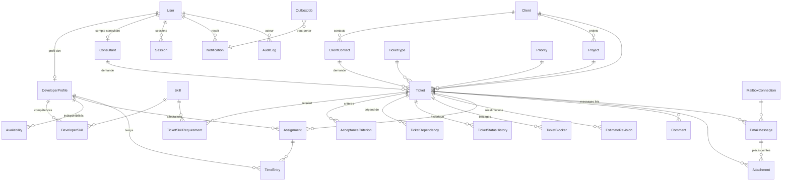

# Modèle de données — DevCapacity Manager

> Livrable **Phase 1** · Version 0.1 (proposition à valider)
> Base : **PostgreSQL 16** · ORM : **Prisma** · Ce schéma deviendra `apps/api/prisma/schema.prisma` en phase 2.

---

## 1. Principes

- Identifiants `uuid` ; `createdAt` / `updatedAt` sur toutes les entités métier.
- Dates-heures en `timestamptz` (UTC) ; jours de planning en `date`.
- E-mails normalisés en **minuscules** avant écriture ; contraintes d'unicité dessus.
- **Données calculées non stockées** : capacité, charge, scores, disponibilité (cf. ADR-07).
- **Dénormalisations documentées** :
  - `Ticket.spentHours` : cumul des `TimeEntry`, mis à jour dans la même transaction que chaque saisie (lecture fréquente sur listes/dashboard).
  - `Assignment.recommendationSnapshot` : copie figée du score au moment de la décision (traçabilité ; ne doit pas être recalculée).
- Référentiels configurables en **tables** (types, priorités, compétences, jours fériés, paramètres) plutôt qu'en enums.
- Suppression : **logique** (`status`/`isActive`) pour les référentiels ; jamais de suppression physique de tickets, affectations ou audit.

---

## 2. Diagramme entités-relations



---

## 3. Schéma Prisma (brouillon)

```prisma
generator client {
  provider = "prisma-client-js"
}

datasource db {
  provider = "postgresql"
  url      = env("DATABASE_URL")
}

// ───────────────────────────── Enums techniques (stables) ─────────────────────────────

enum Role {
  HEAD
  DEVELOPER
  CONSULTANT
  ADMIN
}

enum RecordStatus {
  ACTIVE
  INACTIVE
  ARCHIVED
}

enum TicketStatus {
  RECEIVED
  TO_QUALIFY
  READY
  ASSIGNED
  IN_PROGRESS
  BLOCKED
  IN_REVIEW
  IN_TESTING
  DELIVERED
  CLOSED
  REJECTED
}

enum TicketSource {
  EMAIL
  FORM
  MANUAL
}

enum AssignmentStatus {
  ACTIVE
  COMPLETED
  RELEASED
}

enum AvailabilityType {
  LEAVE
  SICK_LEAVE
  TRAINING
  RESERVED_ACTIVITY
  OTHER
}

enum ApprovalStatus {
  REQUESTED
  APPROVED
  REJECTED
}

enum CommentVisibility {
  INTERNAL
  CONSULTANT
}

enum CommentSource {
  APP
  EMAIL
}

enum ScanStatus {
  PENDING
  CLEAN
  INFECTED
  SKIPPED
  FAILED
}

enum MailProviderKind {
  MICROSOFT_GRAPH
  GMAIL
}

enum EmailDirection {
  INBOUND
  OUTBOUND
}

enum EmailProcessingStatus {
  NEW
  PENDING_QUALIFICATION
  TICKET_CREATED
  LINKED
  ASSIGNMENT_PROPOSED
  IGNORED
  REJECTED
  DUPLICATE
  ERROR
}

enum SenderKind {
  INTERNAL_TEAM
  CONSULTANT
  CLIENT_CONTACT
  UNKNOWN
}

enum JobStatus {
  PENDING
  RUNNING
  SUCCEEDED
  FAILED
  DEAD
}

enum ProfileStatus {
  ACTIVE
  ON_LEAVE
  INACTIVE
}

// ───────────────────────────── Identité et accès ─────────────────────────────

model User {
  id            String    @id @default(uuid()) @db.Uuid
  email         String    @unique // normalisé minuscules, ex. prenom.nom@safirconsulting.net
  firstName     String
  lastName      String
  roles         Role[]
  isActive      Boolean   @default(true)
  entraObjectId String?   @unique // "oid" Entra ID (SSO)
  passwordHash  String? // repli local uniquement (argon2id), null pour SSO
  locale        String    @default("fr")
  timezone      String    @default("UTC")
  lastLoginAt   DateTime?
  createdAt     DateTime  @default(now())
  updatedAt     DateTime  @updatedAt

  developerProfile DeveloperProfile?
  consultant       Consultant?
  sessions         Session[]
  notifications    Notification[]
  auditLogs        AuditLog[]        @relation("AuditActor")
  comments         Comment[]
  assignmentsMade  Assignment[]      @relation("AssignedBy")
}

model Session {
  id          String   @id @default(uuid()) @db.Uuid
  userId      String   @db.Uuid
  tokenHash   String   @unique // hash SHA-256 du cookie, jamais le jeton en clair
  csrfSecret  String
  expiresAt   DateTime
  lastSeenAt  DateTime @default(now())
  ipHash      String?
  userAgent   String?
  createdAt   DateTime @default(now())
  user        User     @relation(fields: [userId], references: [id], onDelete: Cascade)

  @@index([userId])
  @@index([expiresAt])
}

// ───────────────────────────── Développeurs et compétences ─────────────────────────────

model DeveloperProfile {
  id                  String        @id @default(uuid()) @db.Uuid
  userId              String        @unique @db.Uuid
  jobTitle            String?
  weeklyCapacityHours Decimal       @default(40) @db.Decimal(5, 2) // contractuelle (affichage)
  weeklySchedule      Json // { "mon": 8, "tue": 8, "wed": 8, "thu": 8, "fri": 8, "sat": 0, "sun": 0 }
  planningFactor      Decimal       @default(1.0) @db.Decimal(3, 2) // part planifiable (cf. business-rules §2.1)
  timezone            String        @default("UTC")
  profileStatus       ProfileStatus @default(ACTIVE)
  experienceSummary   String? // expérience pertinente (texte libre, sans donnée personnelle superflue)
  createdAt           DateTime      @default(now())
  updatedAt           DateTime      @updatedAt

  user           User                    @relation(fields: [userId], references: [id])
  skills         DeveloperSkill[]
  availabilities Availability[]
  assignments    Assignment[]
  timeEntries    TimeEntry[]
  exclusions     AssignmentExclusion[]
}

model Skill {
  id          String   @id @default(uuid()) @db.Uuid
  name        String   @unique
  category    String // ex. "SAP", "Web", "Données", "Transverse"
  description String?
  isActive    Boolean  @default(true)
  createdAt   DateTime @default(now())
  updatedAt   DateTime @updatedAt

  developerSkills    DeveloperSkill[]
  ticketRequirements TicketSkillRequirement[]
}

model DeveloperSkill {
  id               String    @id @default(uuid()) @db.Uuid
  developerId      String    @db.Uuid
  skillId          String    @db.Uuid
  proficiencyLevel Int // 1..5 (CHECK en migration SQL)
  validatedAt      DateTime?
  validatedById    String?   @db.Uuid
  validationSource String? // ex. "auto-déclaration", "validé HEAD", "certification"
  notes            String?
  createdAt        DateTime  @default(now())
  updatedAt        DateTime  @updatedAt

  developer DeveloperProfile @relation(fields: [developerId], references: [id])
  skill     Skill            @relation(fields: [skillId], references: [id])

  @@unique([developerId, skillId])
  @@index([skillId, proficiencyLevel])
}

model Availability {
  id             String           @id @default(uuid()) @db.Uuid
  developerId    String           @db.Uuid
  type           AvailabilityType
  startDateTime  DateTime
  endDateTime    DateTime
  capacityImpact Decimal          @default(1.0) @db.Decimal(3, 2) // 1.0 = totale, 0.5 = mi-temps
  approvalStatus ApprovalStatus   @default(REQUESTED)
  approvedById   String?          @db.Uuid
  notes          String?
  createdAt      DateTime         @default(now())
  updatedAt      DateTime         @updatedAt

  developer DeveloperProfile @relation(fields: [developerId], references: [id])

  @@index([developerId, startDateTime, endDateTime])
}

model PublicHoliday {
  id        String   @id @default(uuid()) @db.Uuid
  date      DateTime @db.Date
  label     String
  calendar  String   @default("default") // permet plusieurs pays/sites
  createdAt DateTime @default(now())

  @@unique([calendar, date])
}

// ───────────────────────────── Clients, consultants, projets ─────────────────────────────

model Client {
  id                 String       @id @default(uuid()) @db.Uuid
  name               String
  reference          String       @unique
  emailDomains       String[] // domaines d'entreprise connus (jamais de domaines publics)
  contactInformation String?
  status             RecordStatus @default(ACTIVE)
  createdAt          DateTime     @default(now())
  updatedAt          DateTime     @updatedAt

  contacts   ClientContact[]
  projects   Project[]
  tickets    Ticket[]
  exclusions AssignmentExclusion[]
}

model ClientContact {
  id              String       @id @default(uuid()) @db.Uuid
  clientId        String       @db.Uuid
  name            String
  email           String       @unique // normalisé
  phone           String?
  jobTitle        String?
  isPersonalEmail Boolean      @default(false) // gmail.com, yahoo.fr…
  validatedById   String?      @db.Uuid
  validatedAt     DateTime?
  status          RecordStatus @default(ACTIVE)
  createdAt       DateTime     @default(now())
  updatedAt       DateTime     @updatedAt

  client  Client   @relation(fields: [clientId], references: [id])
  tickets Ticket[]
}

model Consultant {
  id           String       @id @default(uuid()) @db.Uuid
  userId       String?      @unique @db.Uuid
  email        String       @unique
  name         String
  organization String? // "Safir Consulting" ou société externe
  isInternal   Boolean      @default(true)
  status       RecordStatus @default(ACTIVE)
  createdAt    DateTime     @default(now())
  updatedAt    DateTime     @updatedAt

  user    User?    @relation(fields: [userId], references: [id])
  tickets Ticket[]
}

model Project {
  id               String       @id @default(uuid()) @db.Uuid
  clientId         String       @db.Uuid
  name             String
  reference        String       @unique
  description      String?
  startDate        DateTime?    @db.Date
  endDate          DateTime?    @db.Date
  status           RecordStatus @default(ACTIVE)
  projectManagerId String?      @db.Uuid
  createdAt        DateTime     @default(now())
  updatedAt        DateTime     @updatedAt

  client  Client   @relation(fields: [clientId], references: [id])
  tickets Ticket[]

  @@index([clientId])
}

// ───────────────────────────── Référentiels configurables ─────────────────────────────

model TicketType {
  id                         String   @id @default(uuid()) @db.Uuid
  code                       String   @unique // ADDON, BUG, EVOLUTION, SPECIFIC_DEV, INTEGRATION, MAINTENANCE, SUPPORT, ANALYSIS
  label                      String
  referencePrefix            String   @unique // ADD, BUG, EVO, DEV, INT, MNT, AST, ANA
  requiresAcceptanceCriteria Boolean  @default(false)
  isActive                   Boolean  @default(true)
  sortOrder                  Int      @default(0)
  createdAt                  DateTime @default(now())
  updatedAt                  DateTime @updatedAt

  tickets Ticket[]
}

model Priority {
  id        String   @id @default(uuid()) @db.Uuid
  code      String   @unique // CRITICAL, HIGH, MEDIUM, LOW
  label     String
  rank      Int      @unique // 1 = plus urgente
  isActive  Boolean  @default(true)
  createdAt DateTime @default(now())
  updatedAt DateTime @updatedAt

  tickets Ticket[]
}

model TicketSequence {
  prefix    String
  year      Int
  lastValue Int    @default(0)

  @@id([prefix, year])
}

model Setting {
  key         String   @id // ex. "recommendation.weights", "capacity.availabilityThreshold", "product.name"
  value       Json
  scope       String // "business" (HEAD) | "technical" (ADMIN)
  updatedById String?  @db.Uuid
  updatedAt   DateTime @updatedAt
}

// ───────────────────────────── Tickets ─────────────────────────────

model Ticket {
  id                      String       @id @default(uuid()) @db.Uuid
  reference               String       @unique // ADD-2026-0001
  title                   String
  description             String
  typeId                  String       @db.Uuid
  priorityId              String       @db.Uuid
  status                  TicketStatus @default(RECEIVED)
  statusBeforeBlock       TicketStatus?
  source                  TicketSource
  clientId                String?      @db.Uuid // obligatoire à partir de READY (contrôle applicatif)
  consultantId            String?      @db.Uuid
  clientContactId         String?      @db.Uuid
  projectId               String?      @db.Uuid
  externalReference       String? // référence du ticket chez le client
  estimatedHours          Decimal?     @db.Decimal(7, 2)
  remainingEstimatedHours Decimal?     @db.Decimal(7, 2)
  spentHours              Decimal      @default(0) @db.Decimal(7, 2) // dénormalisé (cf. §1)
  progressPercent         Int          @default(0)
  plannedStartDate        DateTime?    @db.Date
  requestedDueDate        DateTime?    @db.Date
  committedDueDate        DateTime?    @db.Date
  estimatedDeliveryDate   DateTime?    @db.Date
  lastProgressAt          DateTime?
  startedAt               DateTime?
  deliveredAt             DateTime?
  closedAt                DateTime?
  rejectionReason         String?
  createdById             String?      @db.Uuid
  createdAt               DateTime     @default(now())
  updatedAt               DateTime     @updatedAt

  type               TicketType               @relation(fields: [typeId], references: [id])
  priority           Priority                 @relation(fields: [priorityId], references: [id])
  client             Client?                  @relation(fields: [clientId], references: [id])
  consultant         Consultant?              @relation(fields: [consultantId], references: [id])
  clientContact      ClientContact?           @relation(fields: [clientContactId], references: [id])
  project            Project?                 @relation(fields: [projectId], references: [id])
  skillRequirements  TicketSkillRequirement[]
  acceptanceCriteria AcceptanceCriterion[]
  dependencies       TicketDependency[]       @relation("DependentTicket")
  dependents         TicketDependency[]       @relation("BlockingTicket")
  statusHistory      TicketStatusHistory[]
  blockers           TicketBlocker[]
  estimateRevisions  EstimateRevision[]
  assignments        Assignment[]
  comments           Comment[]
  attachments        Attachment[]
  emailMessages      EmailMessage[]
  exclusions         AssignmentExclusion[]

  @@index([status, priorityId])
  @@index([clientId, projectId])
  @@index([committedDueDate])
}

model TicketSkillRequirement {
  id           String  @id @default(uuid()) @db.Uuid
  ticketId     String  @db.Uuid
  skillId      String  @db.Uuid
  minimumLevel Int // 1..5
  isMandatory  Boolean @default(true)
  weight       Decimal @default(1) @db.Decimal(4, 2)

  ticket Ticket @relation(fields: [ticketId], references: [id], onDelete: Cascade)
  skill  Skill  @relation(fields: [skillId], references: [id])

  @@unique([ticketId, skillId])
}

model AcceptanceCriterion {
  id            String    @id @default(uuid()) @db.Uuid
  ticketId      String    @db.Uuid
  description   String
  sortOrder     Int       @default(0)
  isValidated   Boolean   @default(false)
  validatedById String?   @db.Uuid
  validatedAt   DateTime?

  ticket Ticket @relation(fields: [ticketId], references: [id], onDelete: Cascade)
}

model TicketDependency {
  id                String   @id @default(uuid()) @db.Uuid
  ticketId          String   @db.Uuid // ticket dépendant
  dependsOnTicketId String?  @db.Uuid // dépendance interne
  externalLabel     String? // ou dépendance externe (ex. "accès SAP client")
  isBlocking        Boolean  @default(true)
  resolvedAt        DateTime?
  createdAt         DateTime @default(now())

  ticket    Ticket  @relation("DependentTicket", fields: [ticketId], references: [id], onDelete: Cascade)
  dependsOn Ticket? @relation("BlockingTicket", fields: [dependsOnTicketId], references: [id])
}

model TicketStatusHistory {
  id         String        @id @default(uuid()) @db.Uuid
  ticketId   String        @db.Uuid
  fromStatus TicketStatus?
  toStatus   TicketStatus
  actorId    String?       @db.Uuid // null = système
  reason     String?
  createdAt  DateTime      @default(now())

  ticket Ticket @relation(fields: [ticketId], references: [id])

  @@index([ticketId, createdAt])
}

model TicketBlocker {
  id           String    @id @default(uuid()) @db.Uuid
  ticketId     String    @db.Uuid
  reason       String
  declaredById String    @db.Uuid
  startedAt    DateTime  @default(now())
  resolvedAt   DateTime?
  resolution   String?

  ticket Ticket @relation(fields: [ticketId], references: [id])

  @@index([ticketId, resolvedAt])
}

model EstimateRevision {
  id                    String   @id @default(uuid()) @db.Uuid
  ticketId              String   @db.Uuid
  assignmentId          String?  @db.Uuid
  previousRemainingHours Decimal? @db.Decimal(7, 2)
  newRemainingHours     Decimal  @db.Decimal(7, 2)
  reason                String?
  authorId              String   @db.Uuid
  createdAt             DateTime @default(now())

  ticket Ticket @relation(fields: [ticketId], references: [id])

  @@index([ticketId, createdAt])
}

// ───────────────────────────── Affectations et temps ─────────────────────────────

model Assignment {
  id                     String           @id @default(uuid()) @db.Uuid
  ticketId               String           @db.Uuid
  developerId            String           @db.Uuid
  allocatedHours         Decimal          @db.Decimal(7, 2)
  remainingHours         Decimal?         @db.Decimal(7, 2) // déclaré par le dev ; sinon règle de repli
  remainingUpdatedAt     DateTime?
  status                 AssignmentStatus @default(ACTIVE)
  assignedById           String           @db.Uuid
  assignedAt             DateTime         @default(now())
  plannedStartDate       DateTime         @db.Date
  plannedEndDate         DateTime         @db.Date
  releasedAt             DateTime?
  releaseReason          String?
  isOverride             Boolean          @default(false)
  overrideReason         String?
  recommendationSnapshot Json? // figé à la décision (dénormalisation documentée)
  createdAt              DateTime         @default(now())
  updatedAt              DateTime         @updatedAt

  ticket      Ticket           @relation(fields: [ticketId], references: [id])
  developer   DeveloperProfile @relation(fields: [developerId], references: [id])
  assignedBy  User             @relation("AssignedBy", fields: [assignedById], references: [id])
  timeEntries TimeEntry[]

  @@index([developerId, status, plannedStartDate, plannedEndDate])
  @@index([ticketId, status])
}

model AssignmentExclusion {
  id          String   @id @default(uuid()) @db.Uuid
  developerId String   @db.Uuid
  clientId    String?  @db.Uuid
  ticketId    String?  @db.Uuid
  reason      String
  createdById String   @db.Uuid
  createdAt   DateTime @default(now())

  developer DeveloperProfile @relation(fields: [developerId], references: [id])
  client    Client?          @relation(fields: [clientId], references: [id])
  ticket    Ticket?          @relation(fields: [ticketId], references: [id])
}

model TimeEntry {
  id            String   @id @default(uuid()) @db.Uuid
  assignmentId  String   @db.Uuid
  developerId   String   @db.Uuid
  workDate      DateTime @db.Date
  durationHours Decimal  @db.Decimal(5, 2) // > 0 et ≤ 24 (CHECK)
  comment       String?
  createdAt     DateTime @default(now())

  assignment Assignment       @relation(fields: [assignmentId], references: [id])
  developer  DeveloperProfile @relation(fields: [developerId], references: [id])

  @@index([developerId, workDate])
  @@index([assignmentId])
}

// ───────────────────────────── Commentaires et pièces jointes ─────────────────────────────

model Comment {
  id             String            @id @default(uuid()) @db.Uuid
  ticketId       String            @db.Uuid
  authorId       String?           @db.Uuid // null si issu d'un e-mail d'expéditeur sans compte
  authorEmail    String?
  content        String
  visibility     CommentVisibility @default(INTERNAL)
  source         CommentSource     @default(APP)
  emailMessageId String?           @db.Uuid
  createdAt      DateTime          @default(now())
  updatedAt      DateTime          @updatedAt

  ticket Ticket @relation(fields: [ticketId], references: [id])
  author User?  @relation(fields: [authorId], references: [id])

  @@index([ticketId, createdAt])
}

model Attachment {
  id               String     @id @default(uuid()) @db.Uuid
  ticketId         String?    @db.Uuid
  emailMessageId   String?    @db.Uuid
  originalFileName String
  storageKey       String     @unique
  contentType      String
  sizeBytes        Int
  sha256           String
  scanStatus       ScanStatus @default(PENDING)
  uploadedById     String?    @db.Uuid
  createdAt        DateTime   @default(now())

  ticket       Ticket?       @relation(fields: [ticketId], references: [id])
  emailMessage EmailMessage? @relation(fields: [emailMessageId], references: [id])
}

// ───────────────────────────── Intégration e-mail ─────────────────────────────

model MailboxConnection {
  id                    String           @id @default(uuid()) @db.Uuid
  provider              MailProviderKind
  mailboxAddress        String // aliko.getheme@safirconsulting.net
  isEnabled             Boolean          @default(false)
  subscriptionId        String?
  subscriptionExpiresAt DateTime?
  inboxDeltaToken       String? // chiffré
  sentItemsDeltaToken   String? // chiffré (détection des envois depuis Outlook)
  lastSyncAt            DateTime?
  lastSyncStatus        String?
  lastErrorCode         String? // jamais de secret ni de contenu
  createdAt             DateTime         @default(now())
  updatedAt             DateTime         @updatedAt

  messages EmailMessage[]

  @@unique([provider, mailboxAddress])
}

model EmailMessage {
  id                 String                @id @default(uuid()) @db.Uuid
  mailboxId          String                @db.Uuid
  provider           MailProviderKind
  direction          EmailDirection
  providerMessageId  String
  internetMessageId  String?
  providerThreadId   String? // conversationId Graph
  senderEmail        String
  senderName         String?
  senderKind         SenderKind            @default(UNKNOWN)
  isPersonalDomain   Boolean               @default(false)
  toRecipients       String[]
  subject            String
  bodyPreview        String? // extrait limité ; corps complet stocké seulement si nécessaire (⚙️ rétention)
  bodyText           String?
  receivedAt         DateTime
  processingStatus   EmailProcessingStatus @default(NEW)
  processingError    String?
  isAutomated        Boolean               @default(false)
  duplicateOfId      String?               @db.Uuid
  extractedProposal  Json? // champs proposés (client, projet, priorité, échéance) + niveau de confiance
  associatedTicketId String?               @db.Uuid
  processedById      String?               @db.Uuid
  processedAt        DateTime?
  createdAt          DateTime              @default(now())
  updatedAt          DateTime              @updatedAt

  mailbox     MailboxConnection @relation(fields: [mailboxId], references: [id])
  ticket      Ticket?           @relation(fields: [associatedTicketId], references: [id])
  attachments Attachment[]

  @@unique([provider, mailboxId, providerMessageId])
  @@index([internetMessageId])
  @@index([providerThreadId])
  @@index([processingStatus, receivedAt])
}

// ───────────────────────────── Notifications, jobs, audit ─────────────────────────────

model Notification {
  id             String    @id @default(uuid()) @db.Uuid
  recipientId    String    @db.Uuid
  type           String // ASSIGNMENT_CREATED, TICKET_BLOCKED, DUE_DATE_RISK…
  title          String
  content        String
  link           String?
  idempotencyKey String    @unique
  readAt         DateTime?
  createdAt      DateTime  @default(now())

  recipient User @relation(fields: [recipientId], references: [id])

  @@index([recipientId, readAt])
}

model OutboxJob {
  id             String    @id @default(uuid()) @db.Uuid
  type           String // mail.fetch, mail.send.assignment, mail.delta-sync, subscription.renew…
  payload        Json // identifiants uniquement, jamais de secret
  idempotencyKey String    @unique
  status         JobStatus @default(PENDING)
  attempts       Int       @default(0)
  maxAttempts    Int       @default(8)
  runAfter       DateTime  @default(now())
  lockedAt       DateTime?
  lockedBy       String?
  lastError      String?
  createdAt      DateTime  @default(now())
  updatedAt      DateTime  @updatedAt

  @@index([status, runAfter])
}

model AuditLog {
  id         String   @id @default(uuid()) @db.Uuid
  actorId    String?  @db.Uuid // null = système
  action     String // TICKET_CREATED, ASSIGNMENT_OVERRIDE, ROLE_CHANGED…
  entityType String
  entityId   String
  metadata   Json? // minimal et non sensible
  createdAt  DateTime @default(now())

  actor User? @relation("AuditActor", fields: [actorId], references: [id])

  @@index([entityType, entityId, createdAt])
  @@index([actorId, createdAt])
}
```

---

## 4. Contraintes complémentaires (migration SQL manuelle)

Prisma ne gère pas nativement les `CHECK` ; ils seront ajoutés dans une migration SQL dédiée :

```sql
ALTER TABLE "DeveloperSkill"        ADD CONSTRAINT chk_level     CHECK ("proficiencyLevel" BETWEEN 1 AND 5);
ALTER TABLE "TicketSkillRequirement" ADD CONSTRAINT chk_min_level CHECK ("minimumLevel" BETWEEN 1 AND 5);
ALTER TABLE "Ticket"                ADD CONSTRAINT chk_progress  CHECK ("progressPercent" BETWEEN 0 AND 100);
ALTER TABLE "Ticket"                ADD CONSTRAINT chk_hours     CHECK ("estimatedHours" IS NULL OR "estimatedHours" > 0);
ALTER TABLE "TimeEntry"             ADD CONSTRAINT chk_duration  CHECK ("durationHours" > 0 AND "durationHours" <= 24);
ALTER TABLE "Assignment"            ADD CONSTRAINT chk_alloc     CHECK ("allocatedHours" > 0);
ALTER TABLE "Assignment"            ADD CONSTRAINT chk_dates     CHECK ("plannedEndDate" >= "plannedStartDate");
ALTER TABLE "Availability"          ADD CONSTRAINT chk_av_dates  CHECK ("endDateTime" > "startDateTime");
ALTER TABLE "TicketDependency"      ADD CONSTRAINT chk_dep       CHECK ("dependsOnTicketId" IS NOT NULL OR "externalLabel" IS NOT NULL);
-- Une seule affectation ACTIVE par (ticket, développeur)
CREATE UNIQUE INDEX uq_active_assignment ON "Assignment" ("ticketId", "developerId") WHERE status = 'ACTIVE';
-- AuditLog append-only : révocation UPDATE/DELETE pour le rôle applicatif
```

---

## 5. Données initiales (seed)

| Référentiel | Contenu |
|---|---|
| `TicketType` | 8 types du cahier §6.2 avec préfixes ADD, BUG, EVO, DEV, INT, MNT, AST, ANA |
| `Priority` | CRITICAL (1), HIGH (2), MEDIUM (3), LOW (4) |
| `Skill` | 11 compétences du cahier §7.2 (catalogue, **aucune** association aux développeurs) |
| `Setting` | pondérations 45/30/15/10, seuils de `business-rules.md`, nom du produit, domaines publics |
| `User` | compte HEAD `aliko.getheme@safirconsulting.net` + compte ADMIN (à fournir) ; les 8 développeurs seront ajoutés quand leurs adresses seront transmises |

Les **données fictives** de démonstration (domaine `@example.test`) sont dans un seed séparé, exécutable uniquement hors production.
